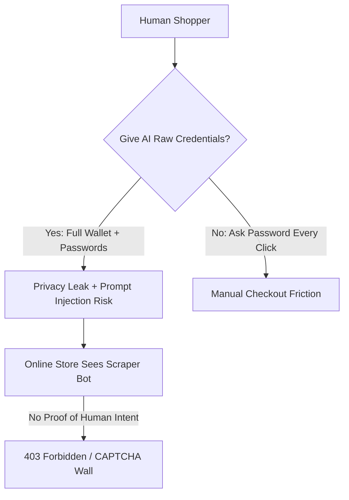
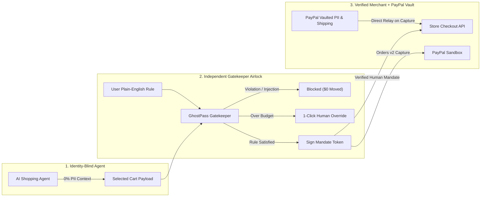

# PayPal GhostPass — Product Vision & Novelty

> **The Blindfolded VIP Checkout Pass for the Agentic Web**
> Built for the PayPal AI Hackathon · Project Workspace: `paypass-agent`

---

## 1. Executive Summary

People want AI shopping agents to handle the tedious parts of e-commerce—searching catalogs, comparing specs and prices, and completing purchases in seconds. Yet the moment an AI agent reaches the **"Checkout / Pay Now"** button, the entire experience collapses under a two-sided trust failure: consumers refuse to hand raw wallets and private identities to fallible bots, and online merchants actively block automated agents as fraud.

**PayPal GhostPass** solves both sides simultaneously with a universal, privacy-preserving agentic checkout passport. Using a **Double-Blind Agentic Handshake**, the AI agent shops completely blindfolded (**0% PII** in its context window), an independent AI Gatekeeper verifies the cart against the human's plain-English spending rule, and PayPal executes scoped Sandbox settlement while relaying the human's vaulted shipping address directly to the merchant.

---

## 2. Detailed Problem Statement (In Simple Everyday Words)

### 2.1 Why AI Shopping Agents Fail Today
Imagine asking a personal assistant to run to a store and buy a \$48 wireless keyboard. Today's AI shopping agents (such as browser-driving assistants like Meta's Muse or autonomous web scrapers) force you into an impossible choice:

#### A. The User's Problem: Lose Privacy & Control, or Lose Speed
1. **Terrifying Blast Radius:** To check out on your behalf today, an AI agent needs your email, home shipping address, store login passwords, and raw PayPal/card details. If the AI hallucinates, misreads a product variant, or falls victim to a hidden **prompt injection** on a shady webpage, it could spend \$500 on non-refundable gift cards instead of a \$20 cable.
2. **Checkout Fatigue:** If you instead force the AI to stop at every checkout screen and wait for you to type your password and click "Pay", you lose the speed and autonomy that made an AI agent useful in the first place.

#### B. The Merchant's Problem: Online Stores Slam the Door Shut
1. **Bot-Defense Blocks (403 & CAPTCHAs):** Major retailers actively block autonomous agents at checkout—for example, Amazon blocking automated scrapers with `403 Forbidden` responses and Walmart challenging suspicious bot sessions with CAPTCHAs.
2. **Zero Proof of Human Authorization:** From the merchant's fraud engine perspective, a browser-scraping AI agent looks indistinguishable from a credential-stuffing attacker or carding bot. The store has zero cryptographic proof that a real human actually approved the purchase.

#### C. Why Closed Store Silos Don't Scale
Some large retailers (like Walmart) have explored closed, merchant-specific "Agent Profiles." That forces consumers to create and maintain separate logins, spending caps, and category rules across 50+ individual stores. Closed silos break the open internet and exclude independent merchants who cannot build custom AI-identity infrastructure.

---

## 3. Our Solution: PayPal GhostPass

**PayPal GhostPass** is a universal digital passport that sits between *any* AI Shopping Agent and *any* Online Store—just like sending a trusted runner to the store with a **smart, locked gift card** instead of handing over your open leather wallet and house keys.

### How It Works in 3 Simple Steps

1. **You Set One Universal Rule (Human Control)**
   - In your PayPal GhostPass bar, you set one plain-English mandate once—for example: *"Max \$60 · Dev gear & tech books only · Block gift cards & subscriptions"*.
   - Your real identity (name, email, home address) and PayPal credentials remain locked inside your PayPal Vault. The AI agent never sees them.

2. **The AI Agent Shops "Blindfolded" (Zero Privacy Leak)**
   - Instead of raw personal credentials, the AI agent receives a scoped, ephemeral GhostPass session token carrying **0% PII**.
   - The AI browses the storefront, compares items, and selects a \$48 mechanical keyboard or \$38 technical book—without ever learning who you are, where you live, or what your PayPal credentials look like.

3. **Two-Way Trust at Checkout (No Store Blocks, No Scams)**
   - **Protects You from Traps:** Before a single cent moves, the **GhostPass AI Gatekeeper** inspects the actual cart payload against your plain-English mandate. If a malicious product description tries to smuggle a \$75 Steam Gift Card into the cart via prompt injection, GhostPass blocks settlement instantly (`\$0.00` moved). If a legitimate item is slightly over your budget (e.g., \$115 headphones vs. \$60 limit), GhostPass pauses cleanly for a single **1-Click Human Approve / Reject** decision.
   - **Proves You're Real to the Store:** When the cart obeys your mandate, PayPal attaches a **Verified Human Mandate** cryptographic header and settles the transaction via **PayPal Sandbox Orders v2**, relaying the vaulted shipping address straight from PayPal to the merchant—so the store drops the CAPTCHA/403 wall and fulfills the order immediately.

---

## 4. True Innovation & Novelty: The Double-Blind Agentic Handshake

Most agentic payment proposals either give the AI agent a virtual credit card *alongside* user PII, or require every merchant to adopt a proprietary retail wallet. GhostPass introduces a **Triple-Blind Separation of Concerns**:

| Dimension | Standard AI Shopping Bot | Closed Store Silo (e.g., Retailer Profile) | PayPal GhostPass (Double-Blind VIP Pass) |
| :--- | :--- | :--- | :--- |
| **AI Agent PII Exposure** | **100% Exposed** (Name, Email, Address, Credentials in context) | Partial / Re-entered per retailer | **0% PII** (Identity-Blind Agent) |
| **Merchant Bot Defense** | **403 Blocked / CAPTCHA** (Looks like an unauthorized scraper) | Whitelisted only inside that 1 retailer | **Cryptographic Human Mandate** (`X-GhostPass-Mandate`) works on any open-web store |
| **Prompt Injection Defense** | None — agent follows injected cart instructions | Static dollar cap only | **Two-Brain Architecture** — independent Gatekeeper audits cart semantics against plain-English policy |
| **Shipping Address Delivery** | Typed into forms by AI bot | Stored separately at every store | **PayPal Vault Relay** — sent directly from PayPal to Merchant upon capture |
| **Cross-Store Portability** | Fragile form-filling | Zero portability (50 silos) | **Universal** — one PayPal rule works everywhere |

---

## 5. Technical Feasibility Today

PayPal GhostPass is not speculative future infrastructure—every building block runs on production-ready APIs today:

1. **PayPal Developer Sandbox REST APIs (`api-m.sandbox.paypal.com`):**
   - Standard OAuth 2.0 Client Credentials flow (`/v1/oauth2/token`) paired with **Orders v2** (`/v2/checkout/orders`) generates real, inspectable Sandbox Order IDs and deterministic settlement states without requiring raw card numbers in the AI loop.
2. **Gemini 2.5 Flash Structured Reasoning (`@google/genai`):**
   - Fast, low-latency structured JSON outputs power the **Two-Brain Split**: Brain 1 (Blind Shopper) interprets natural-language shopping intents over the catalog; Brain 2 (Gatekeeper Auditor) independently evaluates cart items, categories, hidden injection text, and budget limits before signing off.
3. **Zero-Config Hybrid Persistence (`src/lib/db.ts`):**
   - Runs immediately out of the box with Server In-Memory + browser `localStorage` persistence for zero-friction hackathon demos, and switches cleanly to **Neon PostgreSQL** (`migrations/001_init.sql`) whenever `DATABASE_URL` is configured.
