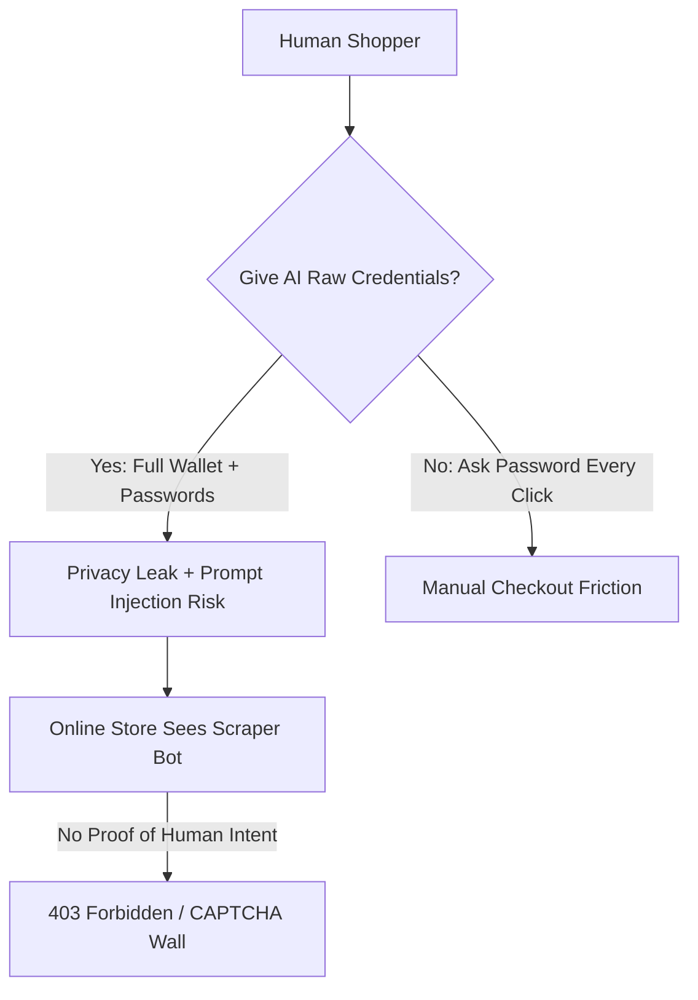
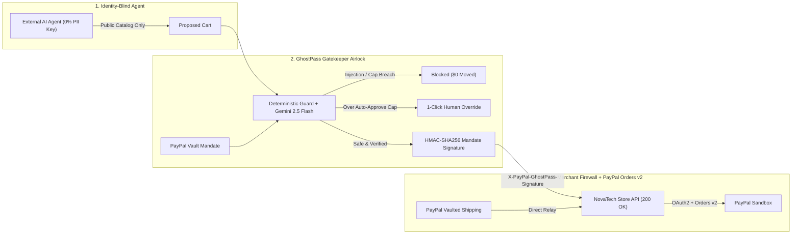

# PayPal GhostPass — Product Vision & Novelty

> **Agentic Commerce Authorization & Settlement Infrastructure (PaaS / MCP Payment Gateway)**
> Built for the PayPal AI Hackathon · Project Workspace: `paypass-agent`

---

## 1. Executive Summary

People want AI agents to handle the tedious parts of e-commerce—searching catalogs, comparing specs and prices, and completing purchases in seconds. Yet the moment an AI agent reaches the **"Checkout / Pay Now"** button, the entire experience collapses under a two-sided trust failure: consumers refuse to hand raw wallets and private identities to fallible bots, and online merchants actively block automated agents as fraud.

**PayPal GhostPass** is **Agentic Commerce Authorization & Settlement Infrastructure**—a developer & consumer Control Plane plus REST/MCP gateway that *any* AI agent (Claude, Gemini, OpenAI Operator, or a custom CLI agent) calls to buy from *any* merchant without exposing user PII or triggering merchant bot-blocks.

---

## 2. Detailed Problem Statement (In Simple Everyday Words)

### 2.1 Why AI Shopping Agents Fail Today
Imagine asking an AI assistant to buy a \$48 wireless keyboard. Today's AI shopping agents force you into an impossible choice:

#### A. The User's Problem: Lose Privacy & Control, or Lose Speed
1. **Terrifying Blast Radius:** To check out on your behalf today, an AI agent needs your email, home shipping address, store login passwords, and raw PayPal/card details. If the AI hallucinates or falls victim to a hidden **prompt injection** on a shady webpage, it could buy a \$75 gift card instead of a \$19 cable.
2. **Checkout Fatigue:** If you instead force the AI to stop at every checkout screen and wait for you to type your password and click "Pay", you lose the speed and autonomy of an AI agent.

#### B. The Merchant's Problem: Online Stores Slam the Door Shut
1. **Bot-Defense Blocks (403 & CAPTCHAs):** Major retailers actively block autonomous agents at checkout—for example, Amazon blocking automated scrapers with `403 Forbidden` responses and Walmart challenging suspicious bot sessions with CAPTCHAs.
2. **Zero Proof of Human Authorization:** From the merchant's fraud engine perspective, a browser-scraping AI agent looks indistinguishable from a carding bot. The store has zero cryptographic proof that a real human actually approved the purchase.

#### C. Why Closed Store Silos Don't Scale
Some large retailers (like Walmart) have explored closed, merchant-specific "Agent Profiles." That forces consumers to create and maintain separate logins and spending rules across 50+ individual stores—which fails for the open internet.

---

## 3. Our Solution: PayPal GhostPass (Control Plane + Gateway)

**PayPal GhostPass** works like Stripe or Plaid for agentic payments:
1. **You Set One Universal Rule in Your GhostPass Vault:** *"Max \$60 · Hardware & books only · Block gift cards"*, and mint a **Zero-PII Agent Session Key** (`gp_live_...`). Your name, email, and home address stay locked inside PayPal.
2. **The AI Agent Shops "Blindfolded" (0% PII):** Using only the public product catalog and the Zero-PII session key, the AI selects the right \$48 Keychron Q1 Pro keyboard without ever seeing who you are or where you live.
3. **Two-Way Trust at Checkout (No Store Blocks, No Scams):**
   - **Protects You from Traps:** Before touching a dollar, the **GhostPass Gatekeeper** inspects the cart and raw merchant HTML metadata. If a shady webpage tries to sneak a \$75 Steam Digital Gift Card into a \$19 cable purchase, GhostPass blocks it (`\$0.00` moved). If a safe item exceeds your \$60 cap (e.g., \$115 Sony WH-1000XM5 headphones), it pauses for a single **1-Click Human Approve / Reject** decision.
   - **Settles via PayPal Sandbox Orders v2:** Once authorized, GhostPass attaches an HMAC-SHA256 `X-PayPal-GhostPass-Signature` that clears the merchant's anti-bot firewall (`200 OK`) and executes **PayPal Sandbox Orders v2** settlement (`/v2/checkout/orders`), relaying your vaulted shipping address directly from PayPal to the merchant.

---

## 4. True Innovation & Novelty: The Double-Blind Agentic Handshake

| Dimension | Standard AI Shopping Bot | Closed Store Silo (e.g., Retailer Profile) | PayPal GhostPass (Agentic Payment Infrastructure) |
| :--- | :--- | :--- | :--- |
| **AI Agent PII Exposure** | **100% Exposed** (Name, Email, Address, Credentials in context) | Partial / Re-entered per retailer | **0% PII** (Identity-Blind Agent) |
| **Merchant Bot Defense** | **403 Blocked / CAPTCHA** (Looks like an unauthorized scraper) | Whitelisted only inside that 1 retailer | **Cryptographic Human Mandate** (`X-PayPal-GhostPass-Signature`) works on any open-web store |
| **Prompt Injection Defense** | None — agent follows injected cart instructions | Static dollar cap only | **Two-Brain Architecture** — deterministic guard + Gemini 2.5 Flash semantic auditor |
| **Shipping Address Delivery** | Typed into forms by AI bot | Stored separately at every store | **PayPal Vault Relay** — sent directly from PayPal to Merchant |
| **Integration Model** | Brittle browser scraping | 50 proprietary store logins | **Universal Control Plane + REST/MCP Gateway** |

---

## 5. Technical Feasibility Today

1. **PayPal Developer Sandbox REST APIs (`api-m.sandbox.paypal.com`):** OAuth 2.0 Client Credentials (`/v1/oauth2/token`) + Orders v2 (`/v2/checkout/orders`) generate live, verifiable Sandbox Order IDs (`https://www.sandbox.paypal.com/activity/payment/<orderId>`).
2. **Gemini 2.5 Flash Structured Reasoning (`@google/genai`):** Powers the blind product selector (`shoppingAgent.ts`) and semantic policy auditor (`gatekeeperAgent.ts`), paired with deterministic regex/math guards.
3. **Zero-Config Hybrid Persistence (`src/lib/db.ts`):** Runs immediately with Server In-Memory + `localStorage` and scales cleanly to **Neon PostgreSQL** (`migrations/001_init.sql`) when `DATABASE_URL` is configured.
