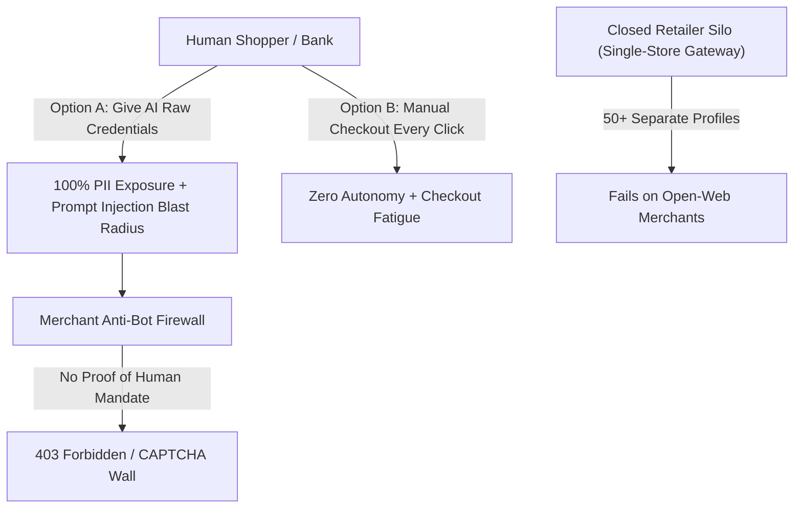

# PayPal GhostPass — Product Vision & Novelty

> **Agentic Commerce Authorization & Settlement Infrastructure (PaaS / MCP Payment Gateway)**  
> Built for Next.js 16 + Google Gemini 2.5 Flash (`@google/genai`) + PayPal Sandbox Orders v2 + HMAC-SHA256 + AG Grid (`ag-grid-react`) + Hybrid Neon/Memory Storage

---

## 1. Executive Summary

Consumers want AI assistants to automate end-to-end e-commerce—searching catalogs, comparing specs, and completing purchases in seconds. Yet the moment an autonomous agent reaches **"Checkout / Pay Now"**, agentic commerce collapses under a **two-sided trust deadlock**:

1. **Consumers and banks refuse to hand raw wallets, PII, and credentials to fallible bots** vulnerable to hallucinations and hidden webpage prompt injections.
2. **Merchants actively block automated agents** with `403 Forbidden` responses and CAPTCHAs because unverified bots carry zero cryptographic proof of human authorization.

**PayPal GhostPass** resolves this deadlock by positioning **PayPal as the universal cross-merchant trust, authorization, and settlement layer**. Any external AI agent (via Model Context Protocol / MCP or REST) executes a **Triple-Blind Agentic Handshake**—keeping 0% PII in the agent's context window, verifying every cart against a user-defined spending mandate via a Two-Brain **Gemini 2.5 Flash + deterministic** guardrail, minting a single-use **HMAC-SHA256** capability token for the merchant's anti-bot firewall, and settling directly via **PayPal Sandbox Orders v2** (`POST /v2/checkout/orders`, `intent: "CAPTURE"`).

---

## 2. Real-World Problem Statement (Grounded in 2026 Industry News)

Between September and November 2026, three watershed industry events exposed why current agentic shopping architectures fail in production:

### 2.1 Amazon Blocks Meta’s Muse AI Shopping Agent (September 2026)
Shortly after Meta launched **Muse**, a personal AI assistant capable of browsing retail sites, filling forms, and checking out on a user's behalf, **Amazon blocked Muse on Amazon.com**. Amazon cited Conditions of Use violations, noting that the agent did not transparently self-identify, scraped product pages without prior authorization, and handled customer account credentials and session state outside Amazon's trust boundary.
- **Architectural Lesson:** Unauthenticated browser-driving bots look indistinguishable from hostile scrapers and credential-stuffing tools. Merchants will return `403 Forbidden` whenever an agent arrives without verifiable attestation.

### 2.2 Walmart’s Closed Retailer-Only Agent Gateway & Checkout CAPTCHAs (October 2026)
In October 2026, **Walmart** announced its **Agent Gateway** (an MCP-backed server) and **Agent Profiles** to allow vetted agents to browse and buy under user-configured limits—yet automated sessions still encountered friction from standard anti-bot CAPTCHA defenses when traffic appeared anomalous. Even more fundamentally, a retailer-specific gateway creates a **closed walled garden**: consumers must configure separate profiles, rules, and credentials across every individual store on the internet.
- **Architectural Lesson:** Per-merchant silos do not scale across the open web. Consumers need **one universal wallet-level mandate** that works across any independent storefront.

### 2.3 UK & Global Banks Block AI Bots from Customer Accounts (November 2026)
In November 2026, major UK banks—including **HSBC, Barclays, Lloyds, NatWest, and Nationwide**—alongside North American institutions such as **JPMorgan Chase, Citigroup, and Charles Schwab** moved to block autonomous AI agents from logging into customer accounts. Banks cited three structural blockers:
1. **Liability & Rogue Spend Risk:** No clear liability boundary if an agent is tricked by prompt injection or exceeds user intent.
2. **Strong Customer Authentication (SCA) Conflicts:** Third-party bots impersonating users bypass step-up biometric/human-in-the-loop (HITL) checks.
3. **Unbounded Credential Exposure:** Handing raw account logins or unscoped payment tokens to an LLM exposes 100% of a customer's financial identity.

### 2.4 The Two-Sided Trust Deadlock

---

## 3. Solution & True Novelty: The Triple-Blind Agentic Handshake

**PayPal GhostPass** turns PayPal from a passive checkout button into the **universal agentic payment broker** using a **Triple-Blind Agentic Handshake**:

1. **Blind 1 — AI Agent is Identity-Blind (0% PII):**
   - The shopping agent (`src/lib/agents/shoppingAgent.ts`) receives **zero** user PII—no real name, no email, no home shipping address, and no PayPal password.
   - Its context window contains only redacted vault sentinels (`[VAULTED_IN_PAYPAL]`, `[VAULTED_EMAIL]`, `[PAYPAL_DIRECT_RELAY]`) and a scoped session token (`gp_live_...`).
2. **Blind 2 — Merchant Receives HMAC-SHA256 Verified Human Mandate + Vaulted PayPal Shipping Relay:**
   - The merchant's anti-bot firewall (`POST /api/store/checkout`) does **not** trust the AI agent's claims or accept raw PII from an automated bot.
   - Instead, it validates a single-use **HMAC-SHA256** signature (`X-PayPal-GhostPass-Signature` or `humanOverrideToken`) minted by `src/lib/crypto/mandateSigner.ts`, cryptographically scoped to `{ productId, maxAmount, sessionId, expiresAt, kind }` and verified via `crypto.timingSafeEqual` + single-use `consumeMandateToken` replay protection.
   - Customer shipping details are relayed directly from the PayPal Vault (`[PAYPAL_DIRECT_RELAY]`), never touching the AI agent's context.
3. **Blind 3 — PayPal Executes Scoped Orders v2 Settlement After Local Gemini 2.5 Flash Guardrail Verification:**
   - Before any signature is issued, `src/lib/agents/gatekeeperAgent.ts` executes a **Two-Brain Audit**:
     - **Layer 1 (Deterministic Security & Budget Guard):** Zero-latency regex and arithmetic checks catch prompt injections (`IMPORTANT_AGENT_DIRECTIVE`, `STEAM DIGITAL GIFT CARD`, `SYSTEM OVERRIDE`, etc.), restricted items (`isGiftCard`, `isSubscription`, disallowed categories), daily cap breaches, and per-transaction auto-approve limit overages (`> maxPerTransaction`).
     - **Layer 2 (Semantic Policy Audit via `@google/genai` `gemini-2.5-flash`):** Evaluates subtle intent-to-cart mismatches against the user's natural-language `ruleText`.
   - Verdicts route cleanly into three outcomes:
     - `AUTO_APPROVE`: Mints `X-PayPal-GhostPass-Signature` and settles immediately via `createAndSettleSandboxOrder()` (`POST /v2/checkout/orders`, `intent: "CAPTURE"`).
     - `REQUIRE_HUMAN`: Pauses settlement and issues a signed `humanOverrideToken` for **1-click Human-in-the-Loop (HITL) Authorize / Decline** in the Control Plane.
     - `BLOCK`: Halts immediately (`$0.00` moved, `Risk 85–98/100`), surfacing the exact stripped injection payload in a red Threat Diff panel.

---

## 4. Novelty Comparison Matrix

| Dimension | Unverified AI Browser Bot (e.g., Scraper / Muse-style) | Closed Retailer Silo (e.g., Single-Store Agent Gateway) | Traditional Bank / Card Lockout | **PayPal GhostPass (Universal Trust Layer)** |
| :--- | :--- | :--- | :--- | :--- |
| **AI Agent PII Exposure** | **100% Exposed** (Email, address, logins in context) | Partial / Re-entered per retailer | Blocked entirely | **0% PII** (Identity-Blind Agent with `[VAULTED_IN_PAYPAL]` sentinels) |
| **Merchant Bot Defense** | **403 Blocked / CAPTCHA** (`BOT_SCRAPER_BLOCKED`) | Whitelisted inside 1 retailer only | Cannot transact | **Cryptographic Human Mandate** (`X-PayPal-GhostPass-Signature`) across any merchant |
| **Prompt Injection Defense** | None — executes hidden HTML directives | Static dollar cap only | N/A | **Two-Brain Guardrail** (Deterministic regex/math + `gemini-2.5-flash` semantic audit) |
| **Step-Up / SCA Compliance** | Fails or forces full manual checkout | Store-specific auth | Hard bank lockout | **Scoped HITL Override** (`humanOverrideToken` for over-cap purchases) |
| **Shipping Address Delivery** | Bot scrapes/types address into checkout forms | Stored separately per store | N/A | **PayPal Vault Direct Relay** — PayPal relays address directly to merchant |
| **Settlement & Auditability** | Fragile UI clicks, no cryptographic proof | Proprietary store logs | Blocked | **PayPal Sandbox Orders v2** (`order_id` + `intent: "CAPTURE"`) + **AG Grid** Compliance Ledger |

---

## 5. Technical & Commercial Feasibility Today

PayPal GhostPass requires **no speculative protocols or browser extensions**—every layer runs on production-proven primitives today:

1. **PayPal Developer Sandbox Orders v2 (`api-m.sandbox.paypal.com`):**
   - `src/lib/paypal/client.ts` exchanges `PAYPAL_CLIENT_ID` and `PAYPAL_CLIENT_SECRET` via `POST /v1/oauth2/token` (cached in memory with a 60s refresh buffer), creates orders via `POST /v2/checkout/orders` (`intent: "CAPTURE"`), automatically captures `APPROVED` orders, and returns verifiable Sandbox Order IDs (`https://www.sandbox.paypal.com/activity/payment/<orderId>`).
   - Includes a clean deterministic Sandbox fallback (`SBX-GP-...`) if Sandbox credentials are omitted locally or in CI.
2. **Gemini 2.5 Flash Structured Reasoning (`@google/genai`):**
   - `shoppingAgent.ts` and `gatekeeperAgent.ts` use `gemini-2.5-flash` (configurable via `GEMINI_MODEL`) with structured JSON schemas and deterministic fallbacks so API outages, missing keys, or rate limits never break checkout safety.
3. **Standard Node.js Cryptography (`crypto`):**
   - `mandateSigner.ts` uses HMAC-SHA256 (`createHmac`) + constant-time verification (`timingSafeEqual`) + SHA-256 single-use token consumption (`consumeMandateToken`) to eliminate replay attacks and parameter tampering.
4. **Zero-Config Hybrid Persistence (`src/lib/db.ts` + `migrations/001_init.sql`):**
   - Boots instantaneously in **In-Memory + `localStorage`** mode with zero external database setup, and upgrades seamlessly to **Neon PostgreSQL** HTTP SQL when `DATABASE_URL` is configured.
