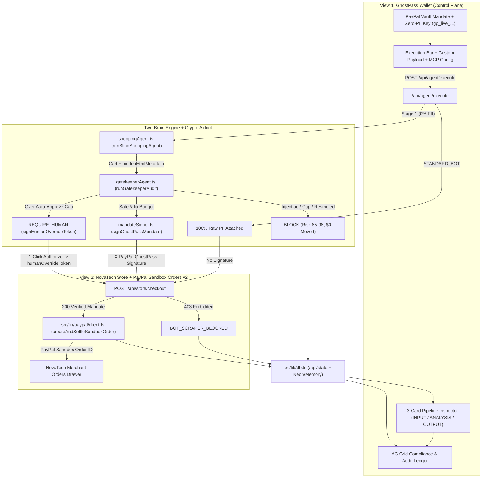
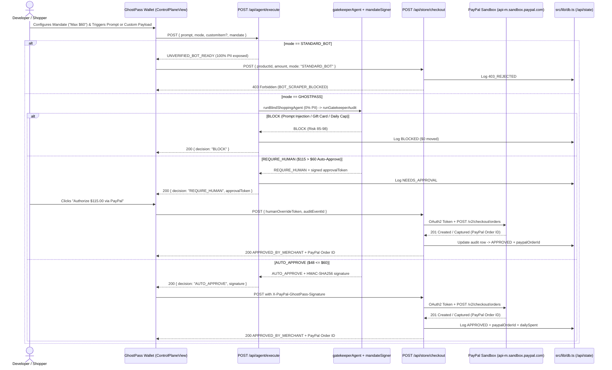

# PayPal GhostPass — System Architecture & Software Design Patterns (ARD)

> Technical Architecture Reference Document (ARD): Clean 2-View Infrastructure App (`GhostPass Wallet` + `NovaTech Store`), Two-Brain Gemini 2.5 Flash pipeline, HMAC-SHA256 mandate attestation, and live PayPal Sandbox Orders v2 settlement.

---

## 1. Architectural Motivation (2026 Industry Context)

In late 2026, three major shifts proved that consumer AI shopping agents cannot rely on raw credential sharing or ad-hoc browser scraping:

1. **Amazon blocking Meta’s Muse AI agent (September 2026):** Unverified shopping bots that scrape pages and simulate human sessions without explicit cryptographic identification trigger immediate Conditions-of-Use blocks (`403 Forbidden`).
2. **Walmart’s closed Agent Gateway & checkout CAPTCHAs (October 2026):** Even when a retailer publishes a proprietary MCP gateway, single-merchant Agent Profiles force users into 50+ fragmented silos—and anti-bot CAPTCHA layers still challenge ambiguous automated checkouts.
3. **UK & global banks blocking AI bots (November 2026):** Major UK lenders (HSBC, Barclays, Lloyds, NatWest, Nationwide) and global institutions blocked autonomous agents from customer accounts due to liability gaps, Strong Customer Authentication (SCA) friction, and unbounded PII/credential exposure.

**PayPal GhostPass** is engineered as a **universal, cross-merchant Agentic Commerce Authorization & Settlement Infrastructure** that eliminates both raw PII leakage and unauthenticated bot traffic.

---

## 2. Clean 2-View Infrastructure Architecture

**PayPal GhostPass** separates the **Agentic Authorization Control Plane** from the **Independent Merchant Storefront**, connected only by standardized REST APIs and HMAC-SHA256 capability headers:

1. **App Shell & View Switcher (`src/components/AppShellHeader.tsx`)**
   - Brand: **PayPal GhostPass** (`PayPal Agentic Guardrail · MCP Authorization & Orders v2 Broker`) with live **`Sandbox Connected`** / **`Sandbox Ready`** indicator.
   - Clean 2-View Switcher: **`GhostPass Wallet`** ⟷ **`NovaTech Store`** (with live settled order count badge), storage mode pill (`Neon SQL` / `Memory`), and **`Reset`** control.
2. **View 1 — GhostPass Wallet / Control Plane (`src/components/ControlPlaneView.tsx` + `src/components/AuditLedgerGrid.tsx`)**
   - **Zone 1 (Mandate Vault & Execution Bar):**
     - **Row 1:** PayPal Vault status strip (`PayPal Vault: <maskedBuyer> · Max/Tx · Daily Left · Rule`), **`Edit Mandate`** modal, and **`MCP Config`** modal (with copyable `@paypal/agent-toolkit` MCP JSON and live `curl` payload).
     - **Row 2:** Mode toggle (**`PayPal Guardrail (Zero-PII)`** vs. **`Unverified Bot (Raw PII)`**), natural-language prompt input, **`Execute`** button, and expandable **`+ Custom Payload`** composer (supporting arbitrary item title, price, category, merchant, and optional `Simulate Malicious Store Injection` test vector).
     - **Row 3:** 3 one-click preset triggers (**`Preset 1: Valid ($48 Keyboard)`**, **`Preset 2: Injection Trap ($19 → $75 Gift Card)`**, **`Preset 3: Over-Cap ($115 Headphones · HITL)`**).
   - **Zone 2 (3-Stage Pipeline Inspector):**
     - **Card 1 (`1 · INPUT: Agent Context`):** Displays `[REDACTED]` / `[PAYPAL_VAULT_RELAY]` / `gp_live_••••` under `PayPal Guardrail` vs. `100% LEAKED` raw PII under `Unverified Bot`.
     - **Card 2 (`2 · ANALYSIS: Guardrail Verdict`):** Displays `Risk Score`, `Policy Check`, `Injection Scan`, `HMAC Signature`, stripped injection Threat Diff box when blocked, and inline **`Authorize $... via PayPal`** / **`Decline`** HITL override controls when `HITL_REQUIRED`.
     - **Card 3 (`3 · OUTPUT: PayPal Orders v2 & Store`):** Displays merchant firewall status (`200 VERIFIED`, `403 BLOCKED`, `422 ABORTED`, or `HOLD (HITL)`), structured PayPal Orders v2 JSON (`paypal_order_id`, `intent: "CAPTURE"`, `amount_usd`, `status`), and **`Verify on PayPal Sandbox ↗`** link.
   - **Zone 3 (Compliance & Audit Ledger):** Filter tabs (`All`, `Settled`, `Blocked`, `HITL Pending`), KPI badges, and `ag-grid-react` ledger (`AuditLedgerGrid.tsx`) showing `SETTLED`, `INJECTION BLOCKED`, `403 SCRAPER BLOCK`, and `HITL REQUIRED` rows.
3. **View 2 — Independent Merchant Storefront (`NovaTech Store` — `StoreNavbar.tsx`, `ProductGrid.tsx`, `StoreCheckoutModal.tsx`)**
   - Pure retail e-commerce experience (8 products across 4 categories with `4:3` Unsplash photography, `Add to Cart`, manual `Buy Now` checkout, and zero GhostPass/AI UI clutter on product cards).
   - Slide-over **`Orders`** fulfillment drawer displaying agent-placed PayPal orders with `Buyer PII Shared: None — Fulfilled via PayPal Vault Relay` and PayPal Sandbox links.

---

## 3. End-to-End Sequence Diagram (Including PayPal Sandbox Orders v2)

---

## 4. API Surface & Server Modules

| Layer | File / Endpoint | Responsibility |
| :--- | :--- | :--- |
| **Agent Execution** | `src/app/api/agent/execute/route.ts` | Runs `runBlindShoppingAgent` + `runGatekeeperAudit`; returns `AUTO_APPROVE`, `REQUIRE_HUMAN`, `BLOCK`, or `UNVERIFIED_BOT_READY`. |
| **Merchant Anti-Bot Firewall** | `src/app/api/store/checkout/route.ts` | Rejects `STANDARD_BOT`, raw PII, or missing/invalid HMAC signatures with `HTTP 403 BOT_SCRAPER_BLOCKED`; redeems single-use tokens and calls `createAndSettleSandboxOrder()`. |
| **Direct PayPal Settlement** | `src/app/api/paypal/settle/route.ts` | Standalone verified settlement endpoint validating HMAC mandate or `humanOverrideToken` before invoking PayPal Sandbox Orders v2. |
| **State & Mandate Persistence** | `src/app/api/state/route.ts` | `GET` / `POST` state hydration, mandate updates, HITL decline status updates, and demo state reset across In-Memory or Neon PostgreSQL. |
| **Health Probe** | `src/app/api/health/route.ts` | Lightweight `GET` readiness endpoint (`{ ok: true, service: "paypal-ghostpass" }`) for Render and Vercel health checks. |
| **Two-Brain Agents** | `src/lib/agents/shoppingAgent.ts`, `src/lib/agents/gatekeeperAgent.ts` | Blind `@google/genai` (`gemini-2.5-flash`) catalog selection + deterministic regex/cap checks + semantic policy audit (with zero-quota `skipLlm` and offline fallback). |
| **Cryptography** | `src/lib/crypto/mandateSigner.ts` | `signGhostPassMandate`, `signHumanOverrideToken`, `verifyGhostPassMandate`, `verifyHumanOverrideToken`, and `consumeMandateToken` (HMAC-SHA256 + `timingSafeEqual`). |
| **PayPal Client** | `src/lib/paypal/client.ts` | `getPayPalAccessToken`, `createAndSettleSandboxOrder` with OAuth2 token caching, 15s timeout, `422` payload retry, and automatic capture on `APPROVED` orders. |
| **Storage Adapter** | `src/lib/db.ts`, `src/lib/clientStorage.ts`, `migrations/001_init.sql` | Strategy pattern switching cleanly between `memory-localstorage` and `neon-postgres`. |

---

## 5. Software Design Patterns & Feasibility Analysis

1. **Mediator / Security Airlock Pattern (`gatekeeperAgent.ts`):** Decouples untrusted catalog/DOM metadata ingestion (`shoppingAgent.ts`) from cryptographic token minting (`mandateSigner.ts`) and PayPal order settlement (`paypal/client.ts`).
2. **Cryptographic Capability Token Pattern (`mandateSigner.ts`):** Single-use HMAC-SHA256 tokens (`X-PayPal-GhostPass-Signature` & `humanOverrideToken`) bound to `{ productId, maxAmount, sessionId, expiresAt, kind }`, verified with constant-time `timingSafeEqual` and invalidated on first use via `consumeMandateToken`.
3. **Token-Cached Gateway Client Pattern (`src/lib/paypal/client.ts`):** Caches PayPal Sandbox OAuth2 tokens with a 60-second safety buffer, retries Orders v2 if sandbox payee metadata returns `422`, captures `APPROVED` orders, and degrades gracefully to deterministic Sandbox simulation IDs (`SBX-GP-...`) if credentials are absent.
4. **Strategy / Adapter Persistence Pattern (`src/lib/db.ts` + `src/lib/clientStorage.ts`):** Zero-config In-Memory + `localStorage` by default; seamless **Neon PostgreSQL** HTTP SQL persistence when `DATABASE_URL` is configured.

### Novelty & Resilience Comparison

| Threat / Failure Vector | Standard AI Shopping Bot | PayPal GhostPass Defense |
| :--- | :--- | :--- |
| **Merchant `403` / CAPTCHA Wall** | Fails checkout; flagged as unverified scraper | Presents `X-PayPal-GhostPass-Signature` + zero raw PII → `200 OK` |
| **Hidden HTML Prompt Injection** | Agent silently adds attacker item (e.g. `$75` gift card) | Deterministic regex + `gemini-2.5-flash` audit halts at `BLOCK` (`$0` moved) |
| **Token Replay or Amount Tampering** | N/A or static API key | Single-use `consumeMandateToken` + `productId` / `maxAmount` HMAC binding |
| **Gemini API Quota / Outage** | Agent pipeline crashes (`500`) | Deterministic catalog matcher & Layer-1 security guard preserve 100% uptime |
| **Over-Budget Hallucination** | Unauthorized charge settled | Paused at `REQUIRE_HUMAN` (`humanOverrideToken`) for 1-click user decision |
