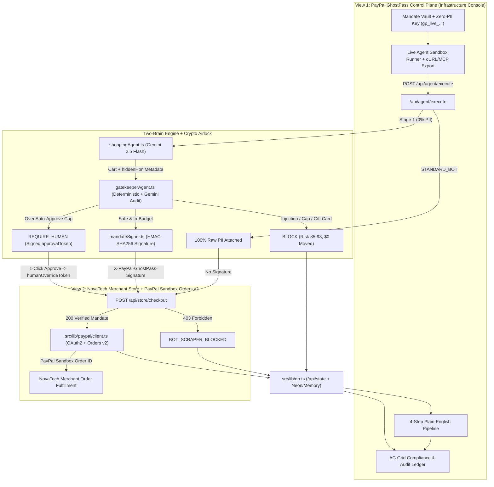
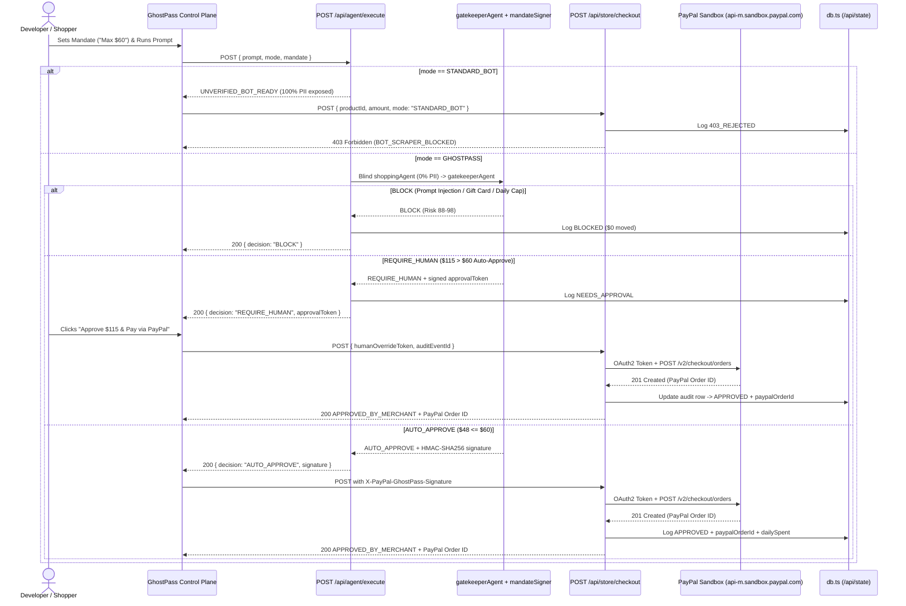

# PayPal GhostPass — System Architecture & Software Design Patterns (ARD)

> Technical Architecture Reference Document (ARD): Clean 2-View Infrastructure App (Control Plane + Live Merchant Storefront), Two-Brain Gemini 2.5 Flash pipeline, HMAC-SHA256 mandate attestation, and live PayPal Sandbox Orders v2 settlement.

---

## 1. Real-World Infrastructure Architecture

**PayPal GhostPass** is structured as a real **Agentic Payment Infrastructure Control Plane** alongside an independent **NovaTech Demo Merchant Storefront**, connected via standardized REST APIs:

1. **App Shell & View Switcher (`src/components/AppShellHeader.tsx`)**
   - Brand: **PayPal GhostPass** (`Agentic Commerce Authorization & Settlement Infrastructure`) + live `PayPal Sandbox Connected` status badge.
   - Clean 2-View Switcher: **`GhostPass Control Plane`** ⟷ **`NovaTech Storefront`**.
2. **View 1 — PayPal GhostPass Control Plane (`src/components/ControlPlaneView.tsx` + `AuditLedgerGrid.tsx`)**
   - **Left Column:** PayPal Vault & Spending Mandate editor (connected Sandbox buyer, plain-English rule, auto-approve cap, daily budget progress bar, copyable Zero-PII session key `gp_live_...`) + **Live Agent Sandbox Runner** (mode toggle, prompt input, 3 quick-test scenarios, copyable `curl`/MCP JSON payload).
   - **Right Column:** Plain-English 4-Step Live Execution Pipeline (**1. Privacy Shield**, **2. Scam & Rule Check**, **3. Store Checkout Gate**, **4. PayPal Sandbox Settlement** with 1-Click Human Approve/Reject and `Verify in PayPal Sandbox ↗`).
   - **Bottom Panel:** KPI summary cards + filterable `ag-grid-react` Compliance & Audit Ledger.
3. **View 2 — Independent Merchant Storefront (`NovaTech` — `StoreNavbar.tsx`, `ProductGrid.tsx`, `StoreCheckoutModal.tsx`)**
   - 100% pure consumer e-commerce store (zero floating popups, zero AI/Mandate branding).
   - Features **NovaTech Order Fulfillment (`Orders`)** showing agent-placed PayPal orders arriving live with their PayPal Sandbox Order IDs and Direct Shipping Relay confirmation.
4. **Server Pipeline (`shoppingAgent.ts`, `gatekeeperAgent.ts`, `mandateSigner.ts`, `paypal/client.ts`, `db.ts`)**
   - **Stage 1 (`src/lib/agents/shoppingAgent.ts`):** Blind `gemini-2.5-flash` catalog selection (`0% PII`) + `hiddenHtmlMetadata` extraction.
   - **Stage 2 (`src/lib/agents/gatekeeperAgent.ts`):** Deterministic math/regex security checks + `gemini-2.5-flash` semantic audit → `BLOCK`, `REQUIRE_HUMAN` (`approvalToken`), or `AUTO_APPROVE` (`X-PayPal-GhostPass-Signature`).
   - **Stage 3 (`POST /api/store/checkout`):** Merchant anti-bot firewall rejecting unverified bots (`HTTP 403 BOT_SCRAPER_BLOCKED`) and verifying HMAC-SHA256 signatures before settling via PayPal.
   - **Stage 4 (`src/lib/paypal/client.ts` & `POST /api/paypal/settle`):** Exchanges `PAYPAL_CLIENT_ID` + `PAYPAL_CLIENT_SECRET` for a cached OAuth2 bearer token at `https://api-m.sandbox.paypal.com/v1/oauth2/token`, creates/captures a PayPal Sandbox order via `POST /v2/checkout/orders`, and persists the `paypalOrderId` in `src/lib/db.ts`.

---

## 2. End-to-End Sequence Diagram (Including PayPal Sandbox Orders v2)

---

## 3. Software Design Patterns Used

1. **Mediator / Airlock Pattern (`gatekeeperAgent.ts`):** Separates untrusted catalog/HTML reading (`shoppingAgent.ts`) from cryptographic authorization (`mandateSigner.ts`) and financial settlement (`paypal/client.ts`).
2. **Cryptographic Capability Token Pattern (`mandateSigner.ts`):** Single-use HMAC-SHA256 tokens (`X-PayPal-GhostPass-Signature` & `humanOverrideToken`) bound to `{ productId, maxAmount, sessionId, expiresAt, kind }` verified with `timingSafeEqual`.
3. **Token-Cached Gateway Client Pattern (`src/lib/paypal/client.ts`):** Caches PayPal Sandbox OAuth2 access tokens in memory with a 60-second safety buffer, retries Orders v2 cleanly if sandbox account metadata mismatches (`422`), and captures `APPROVED` orders automatically.
4. **Strategy / Adapter Pattern (`src/lib/db.ts` + `src/lib/clientStorage.ts`):** Zero-config In-Memory + `localStorage` by default; seamless **Neon PostgreSQL** HTTP SQL persistence when `DATABASE_URL` is configured.
