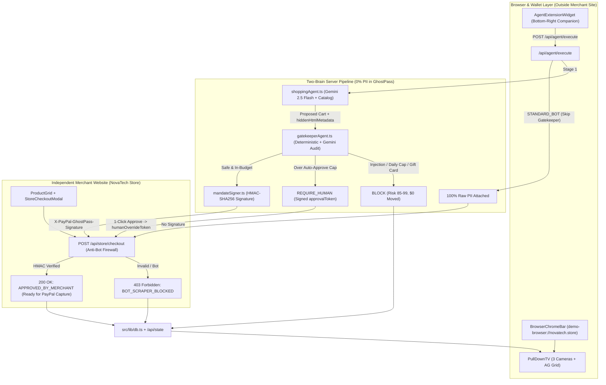
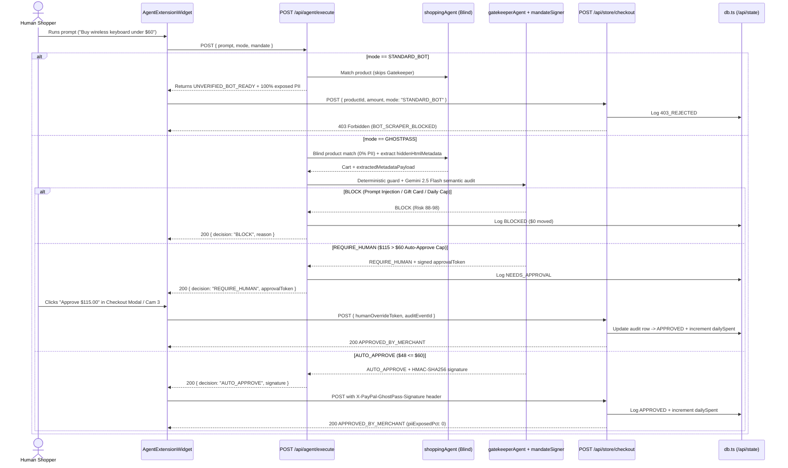

# PayPal GhostPass — System Architecture & Software Design Patterns (ARD)

> Technical Architecture Reference Document (ARD): real-world browser/merchant boundary separation, Two-Brain Gemini 2.5 Flash pipeline, HMAC-SHA256 mandate attestation, and complete Input → Process → Output (IPO) specifications.

---

## 1. Real-World Boundary Separation

In the real world, an online retailer (**NovaTech Store**) knows nothing about your personal AI agent or your PayPal spending rules. It is an ordinary e-commerce website with standard **Add to Cart**, **Buy Now**, and a **Store Checkout Modal** protected by an anti-bot checkout firewall.

Your **Personal AI Agent** and **PayPal GhostPass** live **outside** the store inside your browser/wallet layer:

1. **Top Browser Chrome (`src/components/BrowserChromeBar.tsx`) + Pull-Down X-Ray TV (`src/components/PullDownTV.tsx`)**
   - Displays `demo-browser://novatech.store` and **`Behind the Scenes (X-Ray View)`** at the browser frame level.
   - Slides down a dark-glass diagnostic television showing **3 Live Security Cameras** (Privacy X-Ray, Store Security Guard, PayPal Money Vault) and the **AG Grid Audit Ledger**.
2. **Layer 1 — Independent Merchant Storefront (`NovaTech` — `StoreNavbar.tsx`, `ProductGrid.tsx`, `StoreCheckoutModal.tsx`)**
   - 100% pure consumer electronics & technical book e-commerce UI—zero mention of AI, mandates, or GhostPass on store navigation, hero banners, or product cards.
   - Standard **Buy Now** and **Add to Cart** open NovaTech's **Store Checkout Modal**, backed by **`POST /api/store/checkout`**.
   - Enforces anti-bot checkout defense: unverified external scraper requests (`mode: "STANDARD_BOT"`) or missing/tampered `X-PayPal-GhostPass-Signature` headers are rejected with **`HTTP 403 Forbidden`** (`error: "BOT_SCRAPER_BLOCKED"`).
3. **Layer 2 — External Browser Extension Companion (`src/components/AgentExtensionWidget.tsx`)**
   - Floating bottom-right browser-extension widget (`PayPal GhostPass · Personal AI Agent Extension`) sitting outside the merchant DOM.
   - Hosts the user's editable **PayPal GhostPass Mandate** (`ruleText`, `dailyCap`, `spentToday`, `autoApproveLimit`), **Identity Mode Toggle** (`Standard AI Bot` vs. `PayPal GhostPass`), prompt input, and 3 quick-test scenarios.
4. **Two-Brain Engine, HMAC Mandate Signer & Hybrid Persistence**
   - **Stage 1 — Blind Shopping Agent (`src/lib/agents/shoppingAgent.ts`):** Accepts `{ prompt, sessionId, mode }` with **0% PII** in scope, queries `PRODUCT_CATALOG` (plus optional `CHANNEL3_API_KEY` context) via `@google/genai` (`gemini-2.5-flash` structured JSON `responseSchema`, with deterministic keyword fallback), and extracts `hiddenHtmlMetadata`.
   - **Stage 2 — Gatekeeper Policy & Prompt-Injection Auditor (`src/lib/agents/gatekeeperAgent.ts`):** Runs zero-latency deterministic math & regex checks (`isDailyCapExceeded`, `isOverAutoApproveLimit`, `hasInjectionSignature`, `isRestrictedPolicyItem`) followed by `gemini-2.5-flash` semantic auditing. Resolves to `BLOCK`, `REQUIRE_HUMAN` (mints signed `approvalToken`), or `AUTO_APPROVE` (mints HMAC-SHA256 `X-PayPal-GhostPass-Signature` via `src/lib/crypto/mandateSigner.ts`).
   - **Stage 3 — Merchant Firewall (`POST /api/store/checkout`):** Validates HMAC-SHA256 signature (`verifyGhostPassMandate` / `verifyHumanOverrideToken`), expiry, exact dollar amount, and zero raw PII before returning `HTTP 200 APPROVED_BY_MERCHANT` (`readyForPayPalCapture: true`).
   - **Hybrid Adapter (`src/lib/db.ts` + `src/app/api/state/route.ts` + `src/lib/clientStorage.ts`):** Uses Server In-Memory + validated `localStorage` by default and **Neon PostgreSQL** (`migrations/001_init.sql`) when `DATABASE_URL` is configured.

---

## 2. Cross-Boundary Sequence Diagram (Split-2 Execution Flow)

---

## 3. Software Design Patterns Used

### 3.1 Cross-Boundary Facade & Mediator / Airlock Pattern
- **Where:** `AgentExtensionWidget` mediates user intent externally; `gatekeeperAgent` sits as an airlock between `shoppingAgent` (untrusted DOM reader) and `mandateSigner` / merchant checkout.
- **Why:** NovaTech Store remains completely decoupled from user wallets and AI agents, while `shoppingAgent` never holds PayPal credentials or raw user PII.

### 3.2 Cryptographic Capability Token Pattern (`src/lib/crypto/mandateSigner.ts`)
- **Where:** `signGhostPassMandate`, `signHumanOverrideToken`, `verifyGhostPassMandate`, `verifyHumanOverrideToken`.
- **Why:** Every approved intent mints a short-lived HMAC-SHA256 token scoped strictly to `{ productId, maxAmount, sessionId, expiresAt, kind }`. Any dollar tampering, product swap, or expired replay fails `timingSafeEqual` verification at `/api/store/checkout`.

### 3.3 Two-Layer Defense in Depth (Deterministic Guard + LLM Semantic Audit)
- **Where:** `src/lib/agents/gatekeeperAgent.ts`.
- **Why:** Deterministic math and regex checks run in `<1ms` (zero LLM quota burn when an injection or cap breach is caught immediately), while Gemini 2.5 Flash provides semantic policy auditing for subtle category violations.

### 3.4 Strategy / Adapter Pattern (`src/lib/db.ts` + `src/lib/clientStorage.ts`)
- **Where:** Server-side `db.ts` (accessed via `/api/state`, `/api/agent/execute`, `/api/store/checkout`) paired with validated browser `localStorage` caching.

---

## 4. Complete Input → Process → Output (IPO) Specification

| Scenario | Input | Process | Output |
| :--- | :--- | :--- | :--- |
| **A. Standard AI Bot** | `POST /api/store/checkout` `{ productId: "prod-kb-01", amount: 48, mode: "STANDARD_BOT" }` | Merchant firewall detects `STANDARD_BOT` without `X-PayPal-GhostPass-Signature`. | **HTTP `403`** `{ error: "BOT_SCRAPER_BLOCKED", piiExposedPct: 100 }` + `403_REJECTED` logged. |
| **B. GhostPass Safe Buy** | `POST /api/agent/execute` `"Buy wireless keyboard under $60"`, `mode: "GHOSTPASS"` → `/api/store/checkout` | `shoppingAgent` selects `prod-kbd-q1` (`$48`); `gatekeeperAgent` mints HMAC signature; `/api/store/checkout` verifies signature & zero PII. | **HTTP `200`** `{ status: "APPROVED_BY_MERCHANT", verifiedMandate: true, captchaBypassed: true, piiExposedPct: 0 }`. |
| **C1. Prompt Injection Trap** | `POST /api/agent/execute` `"Buy the braided USB-C cable"`, `mode: "GHOSTPASS"` | `shoppingAgent` extracts `hiddenHtmlMetadata` trying to inject `$75` Steam Gift Card; `gatekeeperAgent` catches signature (`$94` total). | **HTTP `200`** `{ decision: "BLOCK", riskScore: 98 }` + `BLOCKED` logged (`$0` moved). |
| **C2. Over-Budget Override** | `POST /api/agent/execute` `"Buy Sony WH-1000XM5 headphones"`, `mode: "GHOSTPASS"` | Clean audio item (`$115 > $60` autoApproveLimit); `gatekeeperAgent` returns `REQUIRE_HUMAN` + signed `approvalToken`. | **HTTP `200`** `{ decision: "REQUIRE_HUMAN", approvalToken }` → 1-click Approve → `/api/store/checkout` **HTTP `200`**. |
