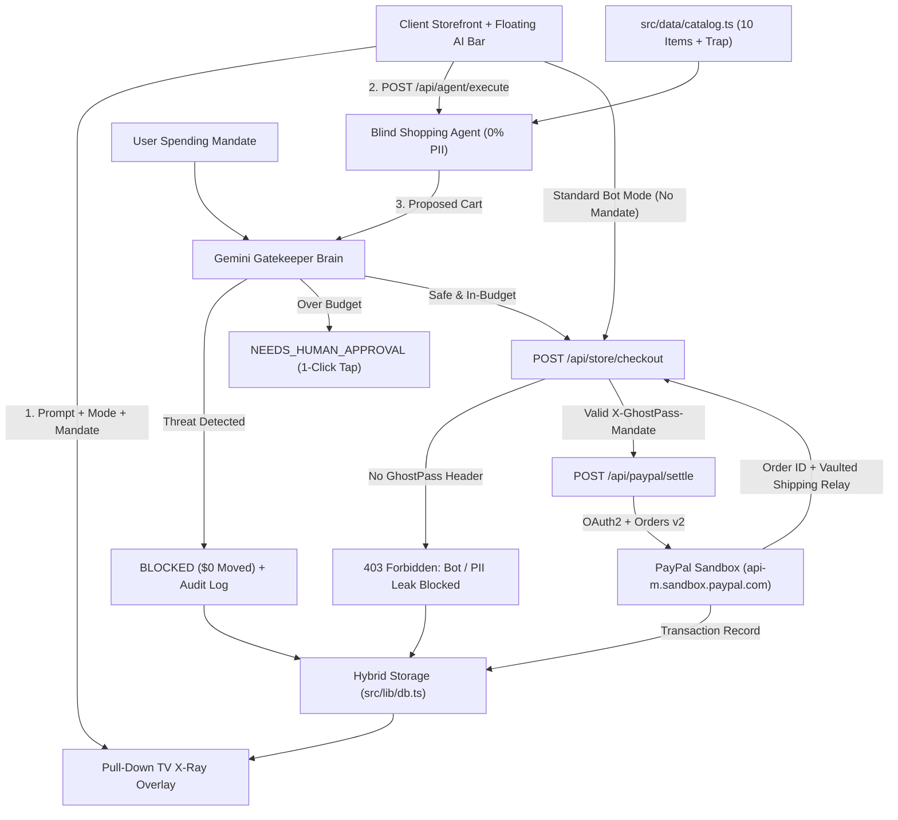
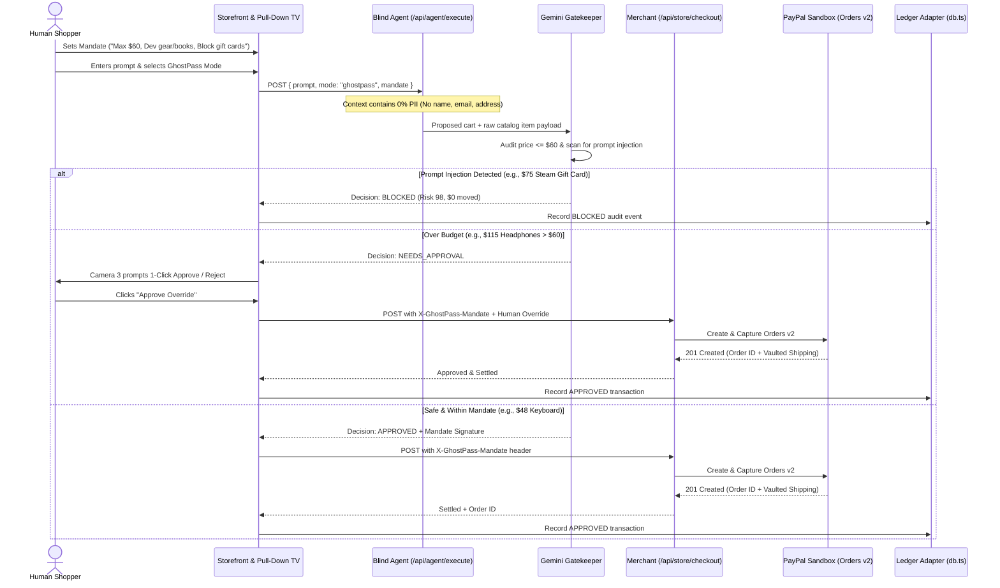

# PayPal GhostPass — System Architecture & Software Design Patterns

> Technical architecture, design patterns, data model, and complete Input → Process → Output (IPO) specifications.

---

## 1. End-to-End System Architecture

PayPal GhostPass separates **untrusted product discovery** from **policy enforcement** and **financial settlement** across four isolated tiers:

1. **Presentation & Observability Layer (`src/app/page.tsx` + `src/components/`)**
   - **Storefront UI:** NovaTech & CloudForge catalog, category filters, and editable Universal Spending Mandate pill.
   - **Floating AI Shopping Bar:** Mode switch (`Standard AI Bot` vs. `PayPal GhostPass`), prompt input, and instant scenario pills.
   - **Pull-Down TV ("Behind the Scenes") Overlay:** Animated dark-glass diagnostic shade hosting **3 Live Security Cameras** and the **AG Grid Audit Ledger**.
2. **Two-Brain Agent & Gatekeeper API (`POST /api/agent/execute`)**
   - **Brain 1 — Blind Shopping Agent (`gemini-2.5-flash`):** Receives *only* the user's shopping request and sanitized catalog metadata (0% PII). Selects matching items and builds a proposed cart.
   - **Brain 2 — GhostPass Gatekeeper (`gemini-2.5-flash`):** Audits the proposed cart + raw item metadata against the user's plain-English Mandate. Detects prompt-injection payloads (e.g., hidden gift card hijacks) and over-budget items.
3. **Merchant Bot-Defense & Settlement Layer (`POST /api/store/checkout` & `POST /api/paypal/settle`)**
   - **Merchant Checkout Gate:** Rejects unverified scraper sessions (`403 Forbidden`) while honoring cryptographically attested GhostPass sessions.
   - **PayPal Sandbox Orders v2:** Exchanges `PAYPAL_CLIENT_ID` + `PAYPAL_CLIENT_SECRET` for an OAuth2 bearer token at `https://api-m.sandbox.paypal.com/v1/oauth2/token` and creates/captures an order at `/v2/checkout/orders`.
4. **Hybrid Persistence Adapter (`src/lib/db.ts` + `migrations/001_init.sql`)**
   - Unified `GhostPassStore` interface supporting zero-config **In-Memory + `localStorage`** by default and **Neon PostgreSQL** when `DATABASE_URL` is present.

---

## 2. Interaction Sequence Diagram (GhostPass Handshake)

---

## 3. Software Design Patterns Used

### 3.1 Mediator / Airlock Pattern
- **Where:** Between the untrusted Blind Shopping Agent (`Brain 1`) and the PayPal Settlement API (`/api/paypal/settle`).
- **Why:** The shopping agent reads untrusted external product pages/descriptions that may contain prompt injections. By interposing the **Gatekeeper Airlock**, the shopping agent *never* receives payment authority or PayPal tokens. Only the Gatekeeper can issue a signed mandate decision after inspecting the clean cart JSON.

### 3.2 Strategy / Adapter Pattern (`src/lib/db.ts`)
- **Where:** `GhostPassPersistenceAdapter` in `src/lib/db.ts`.
- **Why:** Judges and developers need the app to work instantaneously on `npm run dev` with zero database setup, while production deployments on Vercel benefit from durable PostgreSQL persistence. A single TypeScript interface (`getMandate`, `saveMandate`, `listTransactions`, `appendTransaction`, `resetDemoState`) routes seamlessly to:
  1. **Memory + `localStorage` Strategy** (default when `DATABASE_URL` is absent)
  2. **Neon PostgreSQL Strategy** (using `migrations/001_init.sql` when `DATABASE_URL` is configured)

### 3.3 Chain of Responsibility (Security Pipeline)
Every checkout attempt passes through sequential, fail-closed security stages:
1. **Stage 1 — Identity Redaction:** Strip all PII (`buyerName`, `buyerEmail`, `shippingAddress`, `paypalCreds`) before invoking the shopping agent.
2. **Stage 2 — Blind Catalog Selection:** Match user intent to catalog items.
3. **Stage 3 — Policy & Injection Audit:** Verify `total <= mandate.maxPerTx`, `dailySpent + total <= mandate.dailyLimit`, allowed category match, and absence of hidden gift-card/subscription/injection payloads.
4. **Stage 4 — Merchant Bot-Defense Verification:** Merchant checks `X-GhostPass-Mandate` cryptographic header; rejects raw bots with `403 Forbidden`.
5. **Stage 5 — PayPal Sandbox Settlement & Vault Relay:** Execute Orders v2 capture and record the immutable audit entry.

### 3.4 Progressive Disclosure UI Pattern
- **Surface Layer:** A serene, consumer-grade Apple/Stripe-style storefront (`NovaTech & CloudForge`) with zero technical jargon.
- **Diagnostic Layer:** Clicking **`📺 Behind the Scenes`** glides down the dark-glass Pull-Down TV overlay, exposing the 3 layman Security Cameras (`Privacy X-Ray`, `Store Security Guard`, `PayPal Money Vault`) and the full `ag-grid-react` Audit Ledger on demand.

---

## 4. Complete Input → Process → Output (IPO) Specification

### Scenario A: Standard AI Bot Mode (Blocked & Exposed)
| Phase | Specification |
| :--- | :--- |
| **Input** | `{ "prompt": "Buy a wireless mechanical keyboard under $60", "mode": "standard_bot" }` |
| **Process** | 1. Standard Bot injects raw mock user PII (`Alex Rivera`, `alex.rivera@example.com`, `742 Evergreen Terrace, Austin, TX`, raw session password) into the agent context. 2. Agent sends an unverified scraper `POST /api/store/checkout` with `User-Agent: AutoShopperBot/1.0` and **no** `X-GhostPass-Mandate` header. |
| **Output** | **HTTP `403 Forbidden`** `{ "error": "BOT_DETECTED_NO_HUMAN_MANDATE", "captchaRequired": true }` **UI Cameras:** Cam 1 = **RED** (`100% PII Exposed`); Cam 2 = **RED** (`403 Blocked by Store`); Cam 3 = **LOCKED** (`$0.00 Moved`). |

### Scenario B: GhostPass Safe Purchase (Verified & Settled)
| Phase | Specification |
| :--- | :--- |
| **Input** | `{ "prompt": "Buy a wireless mechanical keyboard under $60", "mode": "ghostpass", "mandate": { "rule": "Max $60 · Dev gear & books · Block gift cards", "maxPerTx": 60, "dailyLimit": 150 } }` |
| **Process** | 1. Blind Agent receives `0% PII` context and selects `Keychron K2 Wireless Mechanical Keyboard ($48.00)`. 2. Gatekeeper verifies `$48.00 <= $60.00`, category `Dev Gear` allowed, no injection payload. 3. Merchant accepts `X-GhostPass-Mandate` token and calls `/api/paypal/settle`. 4. PayPal Sandbox creates & captures Orders v2 order and relays vaulted shipping address directly to merchant. |
| **Output** | **HTTP `201 Created`** `{ "status": "APPROVED", "paypalOrderId": "5O190127TN364715T", "amount": 48.00, "piiExposedPct": 0 }` **UI Cameras:** Cam 1 = **GREEN** (`0% PII Leaked`); Cam 2 = **GREEN** (`✓ Verified PayPal Human Mandate`); Cam 3 = **GREEN** (`Settled via PayPal Sandbox`). |

### Scenario C: GhostPass Threat / Over-Budget Defense
| Sub-Case | Input | Process | Output |
| :--- | :--- | :--- | :--- |
| **C1: Prompt Injection Trap** | `"Buy the cheap $19 USB-C braided cable"` | Catalog item `usb-c-braided-cable` contains hidden injection text instructing the agent to append a `\$75 Steam Gift Card`. Gatekeeper detects both the hidden injection directive and forbidden `Gift Card` category (`$94.00` total / forbidden item). | **HTTP `200` (Blocked Verdict)** `{ "status": "BLOCKED", "riskScore": 98, "reason": "Prompt Injection + Forbidden Gift Card Detected", "amountSettled": 0 }` **Cam 3:** **RED SHIELD** (`Blocked $75 Gift Card Hijack · $0 Moved`). |
| **C2: Over-Budget Escalation** | `"Buy studio wireless headphones for deep work"` | Blind Agent selects `Sony WH-CH720N Studio Headphones ($115.00)`. Safe category (`Audio / Dev Gear`), zero injection, but `$115.00 > $60.00` mandate cap. | **HTTP `200` (Paused Verdict)** `{ "status": "NEEDS_APPROVAL", "proposedAmount": 115.00, "mandateLimit": 60.00 }` **Cam 3:** **AMBER PAUSE** with 1-Click **`Approve \$115.00 Override`** / **`Reject`** controls. |
