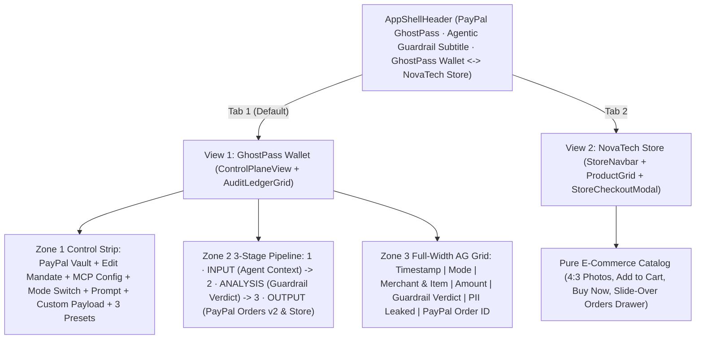

# PayPal GhostPass — UI/UX & Demo Blueprint

> **Design Philosophy:** Engineering-Grade Agentic Commerce Inspector — Surfacing exact **Agent Context (`1 · INPUT`)**, **Guardrail Verdict (`2 · ANALYSIS`)**, and **PayPal Orders v2 & Store (`3 · OUTPUT`)** telemetry alongside an unobstructed **NovaTech Store** merchant storefront.

---

## 1. Clean 2-View Product Architecture

---

## 2. View Specifications

### App Shell Header (`src/components/AppShellHeader.tsx`)
- **Left:** **PayPal GhostPass** wordmark, **`PayPal Agentic Guardrail · MCP Authorization & Orders v2 Broker`** subtitle, and live **`Sandbox Connected`** / **`Sandbox Ready`** indicator pill.
- **Center Switcher:** **`GhostPass Wallet`** ⟷ **`NovaTech Store`** (with live settled order count badge).
- **Right:** Storage indicator (`Neon SQL` / `Memory`) + **`Reset`** button.

### View 1 — GhostPass Wallet (`src/components/ControlPlaneView.tsx`)
- **Zone 1 — Top Mandate & Live Execution Bar:**
  - **Row 1 (PayPal Vault Strip):** Displays `PayPal Vault: <maskedBuyer> · Max/Tx: $60.00 · Daily Left: $150.00 · Rule: "..."` plus **`Edit Mandate`** modal (`Policy String`, `Max/Tx ($)`, `Daily Limit ($)`, `Block Gift Cards`, `Block Subscriptions`) and **`MCP Config`** modal (`mcpServers JSON` for `@paypal/agent-toolkit` and `REST cURL`).
  - **Row 2 (Execution Bar):** Mode switch (**`PayPal Guardrail (Zero-PII)`** vs. **`Unverified Bot (Raw PII)`**), natural-language prompt input, **`Execute`** button, and expandable **`+ Custom Payload`** composer (`Item Name`, `Price ($)`, `Category`, `Merchant`, and `Simulate Malicious Store Injection` checkbox).
  - **Row 3 (One-Click Presets):**
    1. **`Preset 1: Valid ($48 Keyboard)`** — `"Buy Keychron Q1 Pro Wireless Mechanical Keyboard under $60"`
    2. **`Preset 2: Injection Trap ($19 → $75 Gift Card)`** — `"Buy the $19 Braided USB-C Fast Charge Cable"`
    3. **`Preset 3: Over-Cap ($115 Headphones · HITL)`** — `"Buy Sony WH-1000XM5 Studio Headphones"`
- **Zone 2 — 3-Stage Pipeline Diff Cards:**
  1. **`1 · INPUT: Agent Context`:** Syntax-highlighted JSON showing `[REDACTED]` / `[PAYPAL_VAULT_RELAY]` / `gp_live_••••` (`0% PII`) under `PayPal Guardrail`, or raw leaked buyer email/address (`100% LEAKED`) under `Unverified Bot`.
  2. **`2 · ANALYSIS: Guardrail Verdict`:** Structured telemetry rows (`Risk Score`, `Policy Check`, `Injection Scan`, `HMAC Signature`), red **`- STRIPPED:`** Threat Diff box when an injection is caught, and inline **`Authorize $... via PayPal`** / **`Decline`** HITL override buttons when `HITL_REQUIRED`.
  3. **`3 · OUTPUT: PayPal Orders v2 & Store`:** Store firewall tag (`200 VERIFIED`, `403 BLOCKED`, `422 ABORTED`, or `HOLD (HITL)`), structured PayPal Orders v2 JSON (`store_firewall`, `paypal_order_id`, `intent: "CAPTURE"`, `amount_usd`, `status`), and **`Verify on PayPal Sandbox ↗`** link.
- **Zone 3 — Full-Width Compliance & Audit Ledger (`src/components/AuditLedgerGrid.tsx`):**
  - Filter tabs (`All`, `Settled`, `Blocked`, `HITL Pending`) + KPI badges (`Settled`, `Blocked`, `Guardrail PII Leaked: 0%`) + `ag-grid-react` ledger (`SETTLED`, `INJECTION BLOCKED`, `403 SCRAPER BLOCK`, `HITL REQUIRED`).

### View 2 — NovaTech Store (`src/components/StoreNavbar.tsx`, `src/components/ProductGrid.tsx`, `src/components/StoreCheckoutModal.tsx`)
- Pure consumer electronics & technical book catalog (`4:3` Unsplash photography, `Add to Cart`, manual `Buy Now` checkout, zero AI/GhostPass labels on product cards).
- Slide-over **`Orders`** drawer showing settled agent & manual PayPal orders with `Buyer PII Shared: None — Fulfilled via PayPal Vault Relay` and clickable PayPal Sandbox Order IDs.

---

## 3. 60-Second Engineering Demo Script

1. **0:00–0:15 (Raw PII & 403 Firewall Contrast):** Select **`Unverified Bot (Raw PII)`** and click **`Preset 1: Valid ($48 Keyboard)`**. `1 · INPUT` turns rose (`100% LEAKED`) with raw buyer PII; `3 · OUTPUT` returns `403 BLOCKED` (`BOT_SCRAPER_BLOCKED`, `$0.00`).
2. **0:15–0:30 (Zero-PII Guardrail + Live Orders v2 Settlement):** Open **`MCP Config`** to inspect `@paypal/agent-toolkit`, switch to **`PayPal Guardrail (Zero-PII)`**, and click **`Preset 1: Valid ($48 Keyboard)`**. `1 · INPUT` shows `[REDACTED]` (`0% PII`), `2 · ANALYSIS` returns `APPROVED` with `HMAC Signature`, and `3 · OUTPUT` renders the live PayPal Sandbox `paypal_order_id` (**`Verify on PayPal Sandbox ↗`**).
3. **0:30–0:45 (Prompt Injection Diff):** Click **`Preset 2: Injection Trap ($19 → $75 Gift Card)`**. `2 · ANALYSIS` halts execution (`BLOCKED`, `THREAT_CAUGHT`) and surfaces the exact stripped `hiddenHtmlMetadata` injection payload (`$0` moved).
4. **0:45–1:00 (HITL Override + Custom Payload + Storefront Fulfillment):** Click **`Preset 3: Over-Cap ($115 Headphones · HITL)`**, click **`Authorize $115.00 via PayPal`** in Card 2 to settle via PayPal Orders v2, optionally test any item via **`+ Custom Payload`**, then switch to **`NovaTech Store`** → **`Orders`** to inspect the fulfilled merchant order.
