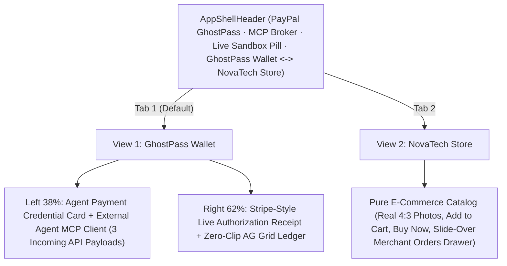

# PayPal GhostPass — UI/UX & Demo Blueprint

> **Design Philosophy:** Zero-clutter Fintech Infrastructure — A crisp **GhostPass Wallet** (Privacy.com + Stripe PaymentIntent aesthetic) paired with a 100% Unobstructed **NovaTech Store**, with zero fake browser chrome, zero tutorial walls, and zero floating extension popups.

---

## 1. Clean 2-View Product Architecture

---

## 2. View Specifications

### App Shell Header (`src/components/AppShellHeader.tsx`)
- **Left:** **PayPal GhostPass** wordmark, `MCP Broker` badge, and compact **`Sandbox Connected`** / **`Sandbox Ready`** indicator pill.
- **Center Switcher:** **`GhostPass Wallet`** ⟷ **`NovaTech Store`** (with live order count badge).
- **Right:** Compact storage badge (`Neon SQL` / `Memory`) + **`Reset`** button.

### View 1 — GhostPass Wallet (`src/components/ControlPlaneView.tsx`)
- **Left Column (`38%`) — Agent Payment Credential & Incoming External MCP Client:**
  - **Programmable Payment Pass (`PayPal GhostPass · Agent Payment Credential`):** Displays `ACTIVE · 0% PII` pill, masked copyable token (`gp_live_••••_8921`), `Max Per Tx: $60.00`, `Daily Remaining: $150.00`, `Allowed Categories: Hardware, Audio, Books`, `Identity Exposure: 0% (PayPal Vault Relay)`, **`Copy MCP Config`** modal (`mcpServers.paypal-ghostpass` JSON + REST cURL tab), and **`Edit Rules`** modal.
  - **External Agent MCP Client (Incoming API Calls):** Mode toggle (`Unverified Bot (Direct)` vs. `GhostPass Authorized`) and 3 one-click incoming webhook payload cards (`POST /mcp/checkout · $48.00`, `POST /mcp/checkout · $19.00 → $75.00 Trap`, `POST /mcp/checkout · $115.00`) simulating external agents (Claude / Gemini / OpenAI Operator) with zero consumer shopping chat input.
- **Right Column (`62%`) — Live Authorization Receipt & Transaction Ledger:**
  - **Live Authorization Receipt:** `POST /mcp/checkout` indicator, 3-node horizontal progression (`1. Blind Context` ── `2. Mandate Audit` ── `3. PayPal Settlement`), 2-column monospace receipt table (`Merchant`, `Requested Item`, `Identity Exposed`, `Security Check`, `Store Firewall`, clickable `PayPal Order ID`), and inline **`Authorize $115.00 via PayPal`** / **`Decline`** bar.
  - **Zero-Clip Transaction Ledger (`src/components/AuditLedgerGrid.tsx`):** Inline filter pills (`All`, `Settled`, `Blocked`, `Pending`), compact KPI badges (`Settled`, `Blocked`, `PII Leaked: 0%`), and `ag-grid-react` table (`Time`, `Agent Mode`, `Item`, `Amount`, `Status`, `PII Leaked`, `PayPal Order ID`) sized proportionally so all columns render without horizontal clipping.

### View 2 — NovaTech Store (`src/components/StoreNavbar.tsx`, `ProductGrid.tsx`, `StoreCheckoutModal.tsx`)
- 100% pure, unobstructed consumer electronics & technical book store (`#FAFAFA` canvas, `#FFFFFF` cards, `Plus Jakarta Sans` + `Inter` + `JetBrains Mono`, real `4:3` Unsplash photography).
- Includes **`Orders (N)`** button opening a right-side slide-over **Merchant Orders Drawer** displaying settled orders with `Buyer PII Shared: None — Fulfilled via PayPal Vault Relay` / `Direct Customer Checkout` and clickable PayPal Sandbox Order IDs.

---

## 3. 90-Second Hackathon Pitch Script

1. **0:00–0:20 (The Bot Problem):** In **GhostPass Wallet**, select `Unverified Bot (Direct)` and trigger **`POST /mcp/checkout · $48.00`**. The Live Authorization Receipt shows `100% Exposed` and `403 Blocked Unverified Bot` on Store Firewall while settled amount stays `$0.00`.
2. **0:20–0:45 (MCP Credential + Live PayPal Settlement):** Open **`Copy MCP Config`** on the GhostPass Card to show `mcpServers.paypal-ghostpass`, switch to `GhostPass Authorized`, and trigger **`POST /mcp/checkout · $48.00`**. `Identity Exposed` stays `0% (PayPal Vault Relay)`, Store Firewall returns `200 Verified Mandate`, and PayPal Sandbox mints a live Order ID.
3. **0:45–1:10 (Prompt Injection Caught):** Trigger **`POST /mcp/checkout · $19.00 → $75.00 Trap`**. `2. Mandate Audit` catches the hidden `$75` Steam Gift Card injection immediately (`Blocked · $0.00 Moved`).
4. **1:10–1:30 (Human Override + Merchant Orders Drawer):** Trigger **`POST /mcp/checkout · $115.00`**. Click **`Authorize $115.00 via PayPal`** in the receipt action bar, then switch to **`NovaTech Store`** → **`Orders`** to inspect the settled order arriving with zero customer PII.
