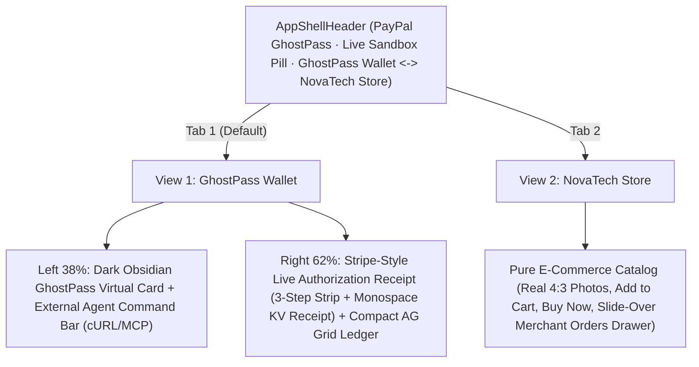

# PayPal GhostPass — UI/UX & Demo Blueprint

> **Design Philosophy:** Zero-clutter Fintech Infrastructure — A crisp **GhostPass Wallet** (Privacy.com + Stripe PaymentIntent aesthetic) paired with a 100% Unobstructed **NovaTech Store**, with zero fake browser chrome, zero tutorial walls, and zero floating extension popups.

---

## 1. Clean 2-View Product Architecture

---

## 2. View Specifications

### App Shell Header (`src/components/AppShellHeader.tsx`)
- **Left:** **PayPal GhostPass** wordmark and compact **`Sandbox Connected`** / **`Sandbox Ready`** indicator pill.
- **Center Switcher:** **`GhostPass Wallet`** ⟷ **`NovaTech Store`** (with live order count badge).
- **Right:** Compact storage badge (`Neon SQL` / `Memory`) + **`Reset`** button.

### View 1 — GhostPass Wallet (`src/components/ControlPlaneView.tsx`)
- **Left Column (`38%`) — Virtual Payment Pass & External Agent Runner:**
  - **Dark Obsidian GhostPass Virtual Card (`#0B1120` with subtle `#0070E0` glow):** Displays `ACTIVE · 0% PII` pill, masked copyable token (`gp_live_••••_8921`), inline editable spending rule & auto-approve cap, remaining daily allowance (`$150.00 left`), and vaulted PayPal buyer label (`sb-***@...`).
  - **External Agent Command Bar:** Mode toggle (`Unverified Bot` vs. `GhostPass Agent`), single-line prompt + `Run` button, 3 compact preset pills (`Keyboard · $48`, `USB-C Cable · $19`, `Headphones · $115`), and toggleable `API` (`cURL` / MCP) drawer.
- **Right Column (`62%`) — Live Authorization Receipt & Transaction Ledger:**
  - **Stripe-Style Authorization Receipt:** Clean 3-node horizontal progression (`1. Blind Context` ── `2. Mandate Audit` ── `3. PayPal Settlement`), 2-column monospace receipt table (`Merchant`, `Item`, `Identity Exposed`, `Security Check`, `Store Firewall`, clickable `PayPal Order ID`), and inline **`Authorize $115.00 via PayPal`** / **`Decline`** bar when human sign-off triggers.
  - **Compact Transaction Ledger (`src/components/AuditLedgerGrid.tsx`):** Inline filter pills (`All`, `Settled`, `Blocked`, `Pending`), compact KPI badges (`Settled`, `Blocked`, `PII Leaked: 0%`), and crisp `260px` `ag-grid-react` table (`Time`, `Pass`, `Item`, `Amount`, `Status`, `PII`, `PayPal Order ID`).

### View 2 — NovaTech Store (`src/components/StoreNavbar.tsx`, `ProductGrid.tsx`, `StoreCheckoutModal.tsx`)
- 100% pure, unobstructed consumer electronics & technical book store (`#FAFAFA` canvas, `#FFFFFF` cards, `Plus Jakarta Sans` + `Inter` + `JetBrains Mono`, real `4:3` Unsplash photography).
- Includes **`Orders (N)`** button opening a right-side slide-over **Merchant Orders Drawer** displaying agent-placed and customer PayPal orders with `Shipping Relayed by PayPal` / `Direct Customer Checkout` and clickable PayPal Sandbox Order IDs.

---

## 3. 90-Second Hackathon Pitch Script

1. **0:00–0:20 (The Bot Problem):** In **GhostPass Wallet**, toggle `Unverified Bot` and click **`Keyboard · $48`**. The Live Authorization Receipt shows `PII Leaked (100%)` and `403 Blocked` on Store Firewall while settled amount remains `$0.00`.
2. **0:20–0:45 (GhostPass + Live PayPal Settlement):** Switch to `GhostPass Agent` and click **`Keyboard · $48`** again. `Identity Exposed` drops to `0% · Blindfolded`, Store Firewall shows `200 OK · Verified`, and PayPal Sandbox mints a live Order ID (`Verify ↗`).
3. **0:45–1:10 (Prompt Injection Caught):** Click **`USB-C Cable · $19`**. `2. Mandate Audit` halts the hidden `$75` Steam Gift Card injection immediately (`Risk 98/100 · $0.00 Moved`).
4. **1:10–1:30 (Human Override + Merchant Orders Drawer):** Click **`Headphones · $115`**. Click **`Authorize $115.00 via PayPal`** in the receipt action bar, then switch to **`NovaTech Store`** → **`Orders`** to view the settled order inside the Merchant Orders drawer.
