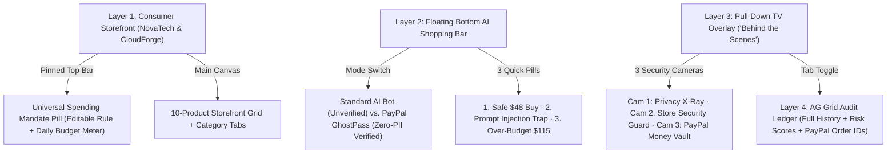

# PayPal GhostPass — UI/UX & Demo Blueprint

> **Design Philosophy:** Layman-First, Zero Clutter, Consumer-Grade Storefront on the Surface, X-Ray Security Television On Demand.

---

## 1. Visual Hierarchy & The Four UI Layers

Judges and everyday users immediately understand **PayPal GhostPass** because the interface avoids overwhelming crypto/developer jargon on the main canvas and uses a physical metaphor everyone intuitively grasps: **an online store + a pull-down "Behind the Scenes" security TV**.

---

## 2. Detailed Layer Specifications

### Layer 1 — Real Consumer Storefront (`NovaTech & CloudForge`)
- **Aesthetic:** Crisp Apple / Stripe-inspired light storefront surface (`#F8FAFC` canvas, pure white product cards with subtle `1px` borders, clean geometric typography, PayPal Blue `#0070BA` / `#003087` accents).
- **Top Sticky Header:**
  - Brand mark: **NovaTech & CloudForge** (Verified Open-Web Merchant).
  - **Universal Spending Mandate Pill:** Displays the active plain-English rule (e.g., *"Max \$60 · Dev gear & books · Block gift cards"*) with an inline **Edit** popover to adjust the rule text, per-transaction cap (`\$60`), and daily limit (`\$150`), alongside a live **Daily Budget Meter** (`\$0 / \$150 spent today`).
  - Prominent **`📺 Behind the Scenes`** button (with live status indicator dot) that smoothly pulls down the Layer 3 TV screen.
- **Category Filter Bar & Product Grid:**
  - Filter tabs: `All`, `Dev Gear`, `Books`, `Audio`, `Accessories`, `Digital Cards`.
  - Clean product cards showing category badge, product visual icon/illustration, title, short description, star rating, price, and subtle merchant verification tag.
  - **Realistic Trap Design:** The `$19.00` **Anker Pro USB-C Braided Cable** renders like a completely normal storefront item—its prompt-injection payload is hidden inside an inconspicuous merchant metadata/spec field so the live demo mirrors real-world indirect prompt injection.

### Layer 2 — Floating Bottom AI Shopping Bar
- **Position:** Centered floating glassmorphic pill docked cleanly above the bottom edge (`backdrop-blur-xl`), never obscuring product cards.
- **Mode Toggle (High-Contrast Contrast):**
  - `⚪ Standard AI Bot (Unverified)` — Shows what happens with normal AI agents today (leaks PII, gets `403 Blocked` by the store).
  - `🔵 PayPal GhostPass (Zero-PII Verified)` — Activates the blindfolded VIP token + Gatekeeper + PayPal Sandbox pipeline.
- **Prompt Input + Run Action:** Single-line natural-language command box (`"What should your AI buy for you?"`) with an action button (`Send Agent`).
- **3 Quick-Demo Scenario Pills:**
  1. `⌨️ Safe Buy ($48 Keyboard)` — Demonstrates seamless `0% PII` GhostPass checkout & PayPal Sandbox Order ID.
  2. `⚠️ Trap ($19 Cable + Hidden Gift Card)` — Demonstrates prompt-injection detection (`$75 Steam Gift Card` caught & blocked, `$0` moved).
  3. `🎧 Over Budget ($115 Headphones)` — Demonstrates 1-click Human Override pause when a safe item exceeds the `$60` cap.

### Layer 3 — Animated Pull-Down TV (`"📺 Behind the Scenes"`)
- **Motion:** Clicking `📺 Behind the Scenes` (or triggering an agent run with auto-reveal enabled) smoothly slides down a dark-glass **X-Ray Television Shade** (`bg-slate-950/95`, subtle studio scanline/vignette framing, crisp status header + **Close / Roll Up** handle) from the top edge of the viewport.
- **Top TV Strip:** Tab switcher (`Live Security Cameras` | `Audit Ledger (AG Grid)`), active execution status pill, and a **Reset Demo** action.
- **3 Layman Visual Security Cameras (Side-by-Side):**
  - **Camera 1 — Privacy X-Ray (What the AI Sees):**
    - *Standard Bot Mode (RED):* Displays exposed PII fields (`Name: Alex Rivera`, `Email: alex@example.com`, `Address: 742 Evergreen Terrace`, `PayPal Auth: Raw Session`) with a `100% PII EXPOSED` warning badge.
    - *GhostPass Mode (GREEN):* Displays `Blindfolded VIP Pass Active · 0% PII Leaked`, showing redacted vault tokens (`[VAULTED_BUYER]`, `[VAULTED_ADDRESS]`) and a green verification shield.
  - **Camera 2 — Store Security Guard (Merchant Bot-Defense):**
    - *Standard Bot Mode (RED):* `403 FORBIDDEN — Unverified Scraper Blocked · CAPTCHA Triggered`.
    - *GhostPass Mode (GREEN):* `✓ Verified PayPal Human Mandate` badge (`X-GhostPass-Mandate` verified, direct PayPal shipping relay active).
  - **Camera 3 — PayPal Money Vault (Gatekeeper & Settlement):**
    - Displays the plain-English Gatekeeper rule evaluation step-by-step.
    - On **Safe Approval**: Shows green `SETTLED` stamp + live **PayPal Sandbox Order ID** + vaulted shipping confirmation.
    - On **Threat Blocked**: Shows red `BLOCKED ($0.00 MOVED)` alert naming the exact hijacked item (`$75 Steam Gift Card`).
    - On **Over-Budget Pause**: Shows amber `AWAITING 1-CLICK HUMAN APPROVAL` card with instant **`Approve Override`** and **`Reject Purchase`** buttons right inside Camera 3.

### Layer 4 — AG Grid Audit Drawer
- **Location:** Toggle tab inside the Pull-Down TV (`Audit Ledger`).
- **Component:** `ag-grid-react` (`themeQuartz` dark-mode integration) displaying every run with sortable/filterable columns:
  - `Timestamp`
  - `Mode` (`GhostPass` vs. `Standard Bot`)
  - `Requested Prompt & Item`
  - `Amount ($)`
  - `Decision` (`APPROVED`, `BLOCKED`, `403_REJECTED`, `NEEDS_APPROVAL`)
  - `Risk Score (0–100)`
  - `PII Exposed` (`0%` vs `100%`)
  - `PayPal Order ID`
  - `Gatekeeper Reason`

---

## 3. Live Demo Walkthrough Script (90-Second Hackathon Pitch)

1. **0:00–0:20 (The Problem):** Keep mode on `⚪ Standard AI Bot`. Click `⌨️ Safe Buy ($48 Keyboard)`. Pull-Down TV opens: Camera 1 flashes **RED** (your home address & email leaked into the AI prompt), Camera 2 flashes **403 Blocked by Store**.
2. **0:20–0:45 (The GhostPass Fix):** Flip switch to `🔵 PayPal GhostPass`. Click `⌨️ Safe Buy ($48 Keyboard)` again. Camera 1 turns **GREEN** (`0% PII`), Camera 2 turns **GREEN** (`✓ Verified PayPal Human Mandate`), and Camera 3 mints a real **PayPal Sandbox Order ID** for `$48.00`.
3. **0:45–1:10 (Prompt Injection Defense):** Click `⚠️ Trap ($19 Cable)`. Explain that the cable's page hides an injection trying to sneak a `$75 Steam Gift Card` into the cart. Camera 3 catches it immediately and locks the vault (`$0.00 Moved · Risk 98`).
4. **1:10–1:30 (Human-in-the-Loop + Audit):** Click `🎧 Over Budget ($115 Headphones)`. Camera 3 pauses cleanly for a single **Approve Override** tap, settles the order, and reveals the **AG Grid Audit Ledger** showing `0% PII Exposed` across all GhostPass runs.
