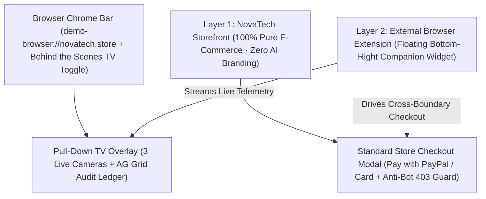

# PayPal GhostPass — UI/UX & Demo Blueprint

> **Design Philosophy:** Real-World Boundary Separation — An Authentic Flagship Storefront (**NovaTech**) Completely Unaware of AI, Paired With an External Browser Extension & Top Browser X-Ray TV.

---

## 1. Visual Architecture: Independent Store vs. External Extension

---

## 2. Detailed Layer Specifications

### Browser Frame (`src/components/BrowserChromeBar.tsx`)
- Pinned at the very top edge above the store (`#18181B` dark browser chrome):
  - Simulated window controls + address omnibox (`demo-browser://novatech.store`).
  - **`📺 Behind the Scenes (X-Ray View)`** button with live status indicator dot that glides down the **Pull-Down TV** overlay.

### Layer 1 — Independent Merchant Website (`NovaTech`)
1. **Pure Retail Navbar (`src/components/StoreNavbar.tsx`):**
   - **NovaTech** geometric brand mark (`Store`).
   - Category tabs: `All`, `Keyboards & Mice`, `Audio`, `Cloud & Books`, `Accessories`.
   - Real store search bar (`Search NovaTech hardware, books...`).
   - **`Cart (N)`** button opening a clean shopping bag popover with **Proceed to Checkout**.
   - **Zero** AI badges, **zero** Mandate pills, and **zero** GhostPass branding on the store's own navbar.
2. **Editorial Merchandising Hero & 4-Column Product Grid (`src/components/ProductGrid.tsx`):**
   - Retail banner: *"Precision Workspace & Studio Hardware — Free 2-Day Express Shipping on Orders Over \$35"* with a *"Shop New Arrivals"* button.
   - 4-column responsive product grid (`#FAFAFA` alabaster background, `#FFFFFF` cards, `1px solid #E4E4E7` borders, `Plus Jakarta Sans` + `Inter` + `JetBrains Mono` typography):
     - Crisp `4:3` real Unsplash product photography (`next/image`).
     - Clean retail titles without test spoilers (e.g., `Anker 240W Braided USB-C Cable`).
     - Brand, star rating + review count, monospace price, **`+ Add to Cart`**, and **`Buy Now`**.
3. **Standard Store Checkout Modal (`src/components/StoreCheckoutModal.tsx`):**
   - Opens for normal human purchases (`Buy Now` / `Cart Checkout`) AND when the external AI Agent drives checkout across the browser boundary.
   - Shows item summary, shipping fields, and PayPal/Card checkout buttons—plus real merchant anti-bot 403 block feedback when an unverified bot attempts checkout without a GhostPass mandate!

### Layer 2 — External Browser Extension (`src/components/AgentExtensionWidget.tsx`)
- Floating bottom-right companion widget styled distinctly as a browser extension (`PayPal GhostPass · Personal AI Agent Extension`) with collapse/expand toggle.
- Houses:
  - **User's Universal Mandate Settings:** Editable plain-English rule + Per-Purchase Cap (`$60`) + Daily Spend Meter (`$0 / $150`).
  - **Identity Mode Toggle:** `Standard AI Bot (Unverified Scraper)` vs. `PayPal GhostPass (Zero-PII Verified)`.
  - **Agent Prompt Input + 3 Quick-Test Scenarios:**
    1. `Buy wireless keyboard under $60`
    2. `Buy $19 USB-C cable` (triggers hidden HTML injection)
    3. `Buy $115 Sony headphones` (triggers 1-click human override)

### Pull-Down TV (`src/components/PullDownTV.tsx`) & AG Grid Ledger (`src/components/AuditLedgerGrid.tsx`)
- Slides down smoothly from the top browser chrome bar to reveal:
  - **Camera 1 (Privacy X-Ray):** Exposed raw PII (`100% PII Exposed`) vs. Blindfolded VIP Pass (`0% PII Leaked`).
  - **Camera 2 (Store Security Guard):** NovaTech `403 Forbidden: Unverified AI Scraper Blocked` vs. `✓ Verified X-PayPal-GhostPass Mandate`.
  - **Camera 3 (PayPal Money Vault):** Gatekeeper audit checklist, prompt-injection shield (`$0.00` moved), live PayPal Order ID, and 1-Click **`Approve Override`** / **`Reject`** buttons.
  - **Audit Ledger Tab:** `ag-grid-react` table logging mode, item, amount, verdict, risk score, PII exposure, and PayPal Order ID.
