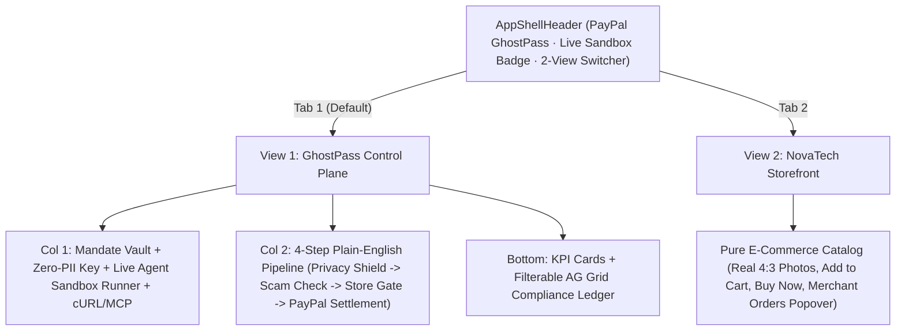

# PayPal GhostPass — UI/UX & Demo Blueprint

> **Design Philosophy:** Clean 2-View Product Infrastructure — A Layman-Clear **GhostPass Control Plane** paired with a 100% Unobstructed **NovaTech Storefront**, with zero fake browser chrome and zero floating extension popups.

---

## 1. Clean 2-View Product Architecture

---

## 2. View Specifications

### App Shell Header (`src/components/AppShellHeader.tsx`)
- **Left:** **PayPal GhostPass** wordmark, `Agentic Commerce Authorization & Settlement Infrastructure` subtitle, and live green **`PayPal Sandbox Connected`** status pill.
- **Center Switcher:** **`GhostPass Control Plane`** ⟷ **`NovaTech Storefront`** (with live order count badge).
- **Right:** Storage backend indicator (`Neon SQL` / `Hybrid Memory`) + **`Reset`** button.

### View 1 — PayPal GhostPass Control Plane (`src/components/ControlPlaneView.tsx`)
- **Column 1 — Mandate Vault & Live Agent Sandbox Runner:**
  - **PayPal Vault & Mandate Card:** Connected Sandbox buyer (`sb-***@...`), editable plain-English rule, auto-approve cap (`$60`), daily budget bar (`$0 / $150`), and copyable Zero-PII Session Key (`gp_live_...`).
  - **Live Agent Sandbox Runner:** Mode selector (`Unverified AI Bot` vs. `PayPal GhostPass`), prompt input, 3 one-click demo buttons, and expandable **`API / MCP` cURL payload** drawer.
- **Column 2 — 4-Step Plain-English Live Execution Pipeline:**
  1. **Privacy Shield:** Plain-English comparison showing *Shared With AI Agent* vs. *Stayed Locked in PayPal Vault*.
  2. **Scam & Rule Check:** Plain-English rule check & prompt-injection catch explanation.
  3. **Store Checkout Gate:** `HTTP 403 Bot-Block` vs. `Verified Human Mandate — Instant Checkout`.
  4. **PayPal Sandbox Settlement:** Real PayPal Sandbox Order ID, USD amount, **`Verify in PayPal Sandbox ↗`** button, and **1-Click `Approve & Pay via PayPal`** / **`Reject`** controls on over-budget runs.
- **Bottom Panel — Compliance & Audit Ledger (`src/components/AuditLedgerGrid.tsx`):**
  - 3 KPI cards (`Total Settled via PayPal`, `Scam / Unauthorized Spend Blocked`, `Personal Data Leaked: 0%`).
  - Filter tabs (`All`, `Paid on PayPal`, `Blocked`, `Needs Approval`) + `ag-grid-react` ledger with clickable PayPal Sandbox links.

### View 2 — NovaTech Storefront (`src/components/StoreNavbar.tsx`, `ProductGrid.tsx`, `StoreCheckoutModal.tsx`)
- 100% pure, unobstructed consumer electronics & technical book store (`#FAFAFA` canvas, `#FFFFFF` cards, `Plus Jakarta Sans` + `Inter` + `JetBrains Mono`, real `4:3` Unsplash photography).
- Includes **`Orders (N)`** fulfillment popover displaying agent-placed PayPal orders arriving at the merchant with `Shipping Relayed by PayPal` and clickable PayPal Sandbox Order IDs.

---

## 3. 90-Second Hackathon Pitch Script

1. **0:00–0:20 (The Bot Problem):** On the **Control Plane**, select `Unverified AI Bot` and click **`1. Buy Wireless Keyboard ($48)`**. Step 1 flashes **100% Personal Info Exposed**; Step 3 flashes **403 Bot-Block**; Step 4 stays at **`$0.00`**.
2. **0:20–0:45 (GhostPass + Live PayPal Settlement):** Switch to `PayPal GhostPass` and click **`1. Buy Wireless Keyboard ($48)`** again. Step 1 shows **`0% Personal Info Exposed`**, Step 3 clears NovaTech's firewall, and Step 4 mints a real **PayPal Sandbox Order ID** (`Verify in PayPal Sandbox ↗`).
3. **0:45–1:10 (Prompt Injection Caught):** Click **`2. Buy USB-C Cable ($19 — Hidden Gift Card Trap)`**. Step 2 catches the hidden `$75` Steam Digital Gift Card injection immediately (`Risk 98/100 · $0.00 Moved`).
4. **1:10–1:30 (1-Click Human Override + Merchant Storefront):** Click **`3. Buy Studio Headphones ($115)`**. Step 4 pauses cleanly; tap **`Approve $115.00 & Pay via PayPal`** to settle a second live PayPal Order ID, then switch to **`NovaTech Storefront`** → **`Orders`** to show the settled order arriving cleanly at the store.
