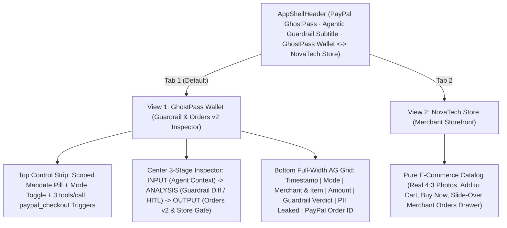

# PayPal GhostPass — UI/UX & Demo Blueprint

> **Design Philosophy:** Engineering-Grade Agentic Commerce Inspector — Surfacing exact **MCP Context (`INPUT`)**, **Guardrail & Risk Telemetry (`ANALYSIS`)**, and **PayPal Orders v2 Settlement (`OUTPUT`)** with zero marketing fluff, paired with an unobstructed **NovaTech Store**.

---

## 1. Clean 2-View Product Architecture

---

## 2. View Specifications

### App Shell Header (`src/components/AppShellHeader.tsx`)
- **Left:** **PayPal GhostPass** wordmark, **`PayPal Agentic Guardrail · MCP Authorization & Orders v2 Broker`** subtitle, and live **`Sandbox Connected`** / **`Sandbox Ready`** indicator pill.
- **Center Switcher:** **`GhostPass Wallet`** ⟷ **`NovaTech Store`** (with live order count badge).
- **Right:** Storage indicator (`Neon SQL` / `Memory`) + **`Reset`** button.

### View 1 — PayPal Agentic Guardrail & MCP Inspector (`src/components/ControlPlaneView.tsx`)
- **Top Control Strip:**
  - Active Scoped Mandate Pill (`Token: gp_live_••••_8921 · Cap: $60/tx · Daily: $150/$150 left · PII: 0% Exposed`) + **`Edit Mandate`** & **`MCP Config`** modals.
  - Mode Switch (`Unverified Agent (Raw PII)` vs. `PayPal Guardrail (Zero-PII)`) + 3 Direct MCP Tool Triggers (`tools/call: paypal_checkout`):
    1. `1. Valid Order ($48 · Keychron Q1)`
    2. `2. Prompt Injection ($19 Cable → $75 Gift Card)`
    3. `3. Over-Cap Order ($115 · Sony XM5 — HITL)`
- **Center 3-Stage Payload & Diff Inspector:**
  1. **`INPUT · Agent Context Window`:** Syntax-styled JSON showing `[REDACTED]` / `[PAYPAL_VAULT_RELAY]` under PayPal Guardrail vs. raw leaked PII under Unverified Agent.
  2. **`ANALYSIS · Guardrail & Policy`:** Structured telemetry rows (`Intent Match`, `Prompt Injection Scan`, `Spend Limit Check`, `Risk Score: X/100`, `HMAC Attestation`), red **`THREAT DIFF`** box showing the exact stripped injection payload when caught, and inline **`Approve` / `Reject`** HITL override buttons when over-cap.
  3. **`OUTPUT · Orders v2 & Store Gate`:** NovaTech firewall status (`200 VERIFIED_MANDATE` vs. `403 SCRAPER_PII_BLOCKED`), structured `POST /v2/checkout/orders` JSON payload (`order_id`, `intent: "CAPTURE"`, `status`, `X-PayPal-Agent-Attestation`), and **`Open in PayPal Sandbox ↗`** link.
- **Bottom Full-Width Audit Ledger (`src/components/AuditLedgerGrid.tsx`):**
  - Filter tabs (`All`, `Settled`, `Blocked`, `HITL Pending`) + KPI badges (`Settled`, `Blocked`, `Guardrail PII Leaked: 0%`) + zero-clip `ag-grid-react` table (`Timestamp`, `Mode`, `Merchant & Item`, `Amount`, `Guardrail Verdict`, `PII Leaked`, `PayPal Order ID`).

### View 2 — NovaTech Store (`src/components/StoreNavbar.tsx`, `ProductGrid.tsx`, `StoreCheckoutModal.tsx`)
- 100% pure, unobstructed consumer electronics & technical book store (`#FAFAFA` canvas, `#FFFFFF` cards, `Plus Jakarta Sans` + `Inter` + `JetBrains Mono`, real `4:3` Unsplash photography).
- Includes **`Orders (N)`** button opening a right-side slide-over **Merchant Orders Drawer** displaying settled orders with `Buyer PII Shared: None — Fulfilled via PayPal Vault Relay` and clickable PayPal Sandbox Order IDs.

---

## 3. 90-Second Engineering Demo Script

1. **0:00–0:20 (Raw PII & 403 Firewall Contrast):** Select `Unverified Agent (Raw PII)` and click **`1. Valid Order ($48 · Keychron Q1)`**. `INPUT` turns rose (`100% PII LEAKED`) with raw buyer PII; `OUTPUT` returns `403 SCRAPER_PII_BLOCKED` (`$0.00`).
2. **0:20–0:45 (Zero-PII Guardrail + Live Orders v2 Settlement):** Open **`MCP Config`** to show `@paypal/agent-toolkit`, switch to `PayPal Guardrail (Zero-PII)`, and click **`1. Valid Order ($48 · Keychron Q1)`**. `INPUT` shows `[REDACTED]` (`0% PII EXPOSED`), `ANALYSIS` returns `PASS` with `HMAC Attestation`, and `OUTPUT` renders the live PayPal Sandbox `order_id` (`Open in PayPal Sandbox ↗`).
3. **0:45–1:10 (Prompt Injection Diff):** Click **`2. Prompt Injection ($19 Cable → $75 Gift Card)`**. `ANALYSIS` halts execution (`INJECTION_DETECTED`, `Risk 98/100`) and surfaces the exact stripped adversarial string inside the red `THREAT DIFF` box.
4. **1:10–1:30 (HITL Override + Storefront Fulfillment):** Click **`3. Over-Cap Order ($115 · Sony XM5 — HITL)`**. Click **`Approve $115.00`** in Panel 2 to settle via PayPal Orders v2, then open **`NovaTech Store`** → **`Orders`** to inspect the fulfilled merchant order.
