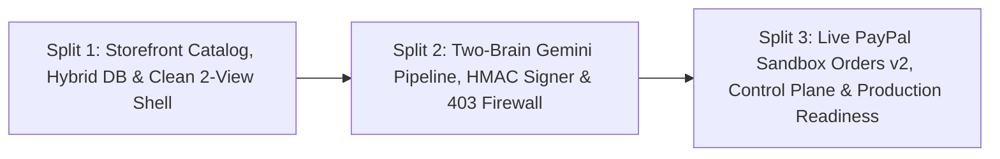

# PayPal GhostPass — Three-Split Execution Plan

> Structured engineering roadmap across all 3 completed vertical slices.

---

## Overview

---

## Split 1: Foundation, Catalog & Storage Adapter (Completed)
- **Catalog (`src/data/catalog.ts`):** 8 NovaTech products across 4 categories (`Keyboards & Mice`, `Audio`, `Cloud & Books`, `Accessories`) with `4:3` Unsplash photos + `hiddenHtmlMetadata` prompt-injection vector on the `$19.00` Braided USB-C Fast Charge Cable (`prod-cable-trap`).
- **Hybrid Persistence (`src/lib/db.ts`, `src/lib/clientStorage.ts`, `src/app/api/state/route.ts`, `migrations/001_init.sql`):** Zero-config Server In-Memory + validated `localStorage` default (`memory-localstorage`), seamlessly upgrading to **Neon PostgreSQL** HTTP SQL (`neon-postgres`) when `DATABASE_URL` is configured.
- **Pure Retail Storefront (`src/components/StoreNavbar.tsx`, `src/components/ProductGrid.tsx`, `src/components/StoreCheckoutModal.tsx`):** Unobstructed retail storefront + slide-over Merchant `Orders` drawer.

---

## Split 2: Two-Brain Gemini Pipeline, HMAC Signing & 403 Firewall (Completed)
- **Contracts & Crypto (`src/types/ghostpass.ts`, `src/lib/crypto/mandateSigner.ts`):** `signGhostPassMandate`, `signHumanOverrideToken`, `verifyGhostPassMandate`, `verifyHumanOverrideToken`, and single-use `consumeMandateToken` using Node `crypto.createHmac("sha256", ...)` + `timingSafeEqual`.
- **Two-Brain Engine (`src/lib/agents/shoppingAgent.ts`, `src/lib/agents/gatekeeperAgent.ts`):** Blind `@google/genai` (`gemini-2.5-flash`) catalog selection (`runBlindShoppingAgent`, `0% PII`) + deterministic math/regex security guard + `gemini-2.5-flash` semantic audit (`runGatekeeperAudit`).
- **APIs (`POST /api/agent/execute`, `POST /api/store/checkout`):** Full `AUTO_APPROVE`, `BLOCK`, `REQUIRE_HUMAN`, `CustomItemInput` payload support, and `HTTP 403 BOT_SCRAPER_BLOCKED` enforcement.

---

## Split 3: Live PayPal Sandbox Orders v2, Control Plane & Production Readiness (Completed)
- **PayPal Sandbox Client & Settlement (`src/lib/paypal/client.ts`, `POST /api/paypal/settle`):**
  - Cached OAuth 2.0 client credentials token exchange (`getPayPalAccessToken` at `https://api-m.sandbox.paypal.com/v1/oauth2/token`).
  - Orders v2 (`createAndSettleSandboxOrder` via `POST /v2/checkout/orders`, `intent: "CAPTURE"`) with `payee.email_address`, `payment_source.paypal`, automatic capture for `APPROVED` orders, `422` retry resilience, and deterministic offline fallback.
  - Wired into `POST /api/store/checkout` for `AUTO_APPROVE`, `HUMAN_OVERRIDE`, and manual storefront settlements.
- **2-View Infrastructure UI (`AppShellHeader.tsx`, `ControlPlaneView.tsx`, `AuditLedgerGrid.tsx`):**
  - Clean **GhostPass Wallet** (`1 · INPUT: Agent Context`, `2 · ANALYSIS: Guardrail Verdict`, `3 · OUTPUT: PayPal Orders v2 & Store`, `Edit Mandate`, `MCP Config`, `+ Custom Payload`, 3 preset chips, KPI badges, and `ag-grid-react` Compliance & Audit Ledger) + **NovaTech Store**.
- **Testing, Docs & Deployment Readiness:**
  - Zero-quota Vitest suites (`tests/unit/mandateSigner.test.ts`, `tests/unit/gatekeeperAgent.test.ts`, `tests/unit/checkoutFirewall.test.ts`, `tests/unit/dbAdapter.test.ts`, `tests/unit/paypalClient.test.ts`, and `tests/integration/pipeline.test.ts`).
  - Health probe (`src/app/api/health/route.ts`), `render.yaml`, Vercel configuration, root MIT `LICENSE`, and comprehensive `README.md` + `docs/01`–`04`.
