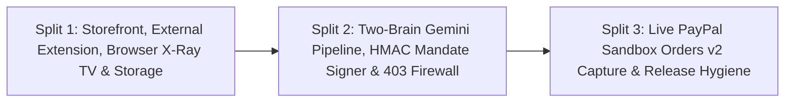

# PayPal GhostPass — Three-Split Execution Plan

> Structured engineering roadmap dividing delivery into 3 clean, build-stable vertical slices.

---

## Overview

To guarantee zero broken builds and keep every milestone independently testable, implementation is divided into **three sequential splits**:

---

## Split 1: Foundation, Storefront UI, External Extension & Pull-Down TV Overlay (Completed)

### Scope & Deliverables
1. **Project Structure Alignment (`src/`):** Next.js 16 App Router under `src/app/` with `@/*` mapped to `./src/*` in `tsconfig.json`.
2. **Product Catalog & Prompt-Injection Dataset (`src/data/catalog.ts`):** Flagship NovaTech catalog with verified Unsplash `4:3` photography and `hiddenHtmlMetadata` prompt-injection trap on `Anker 240W Braided USB-C Cable` (`$19.00` attempting to inject `$75.00` Steam Digital Gift Card).
3. **Hybrid Persistence Adapter (`src/lib/db.ts`, `src/lib/clientStorage.ts`, `src/app/api/state/route.ts`, `migrations/001_init.sql`):** Server In-Memory + validated `localStorage` default with automatic Neon PostgreSQL HTTP SQL support when `DATABASE_URL` is configured.
4. **Clean Boundary UI:**
   - Top browser frame (`BrowserChromeBar.tsx`) + dark-glass Pull-Down X-Ray TV (`PullDownTV.tsx` + `AuditLedgerGrid.tsx`).
   - Pure NovaTech e-commerce storefront (`StoreNavbar.tsx`, `ProductGrid.tsx`, `StoreCheckoutModal.tsx`) with zero AI/GhostPass leaks.
   - Floating bottom-right External Browser Extension (`AgentExtensionWidget.tsx`).

---

## Split 2: Two-Brain Gemini Pipeline, HMAC Mandate Signing & Merchant Anti-Bot Firewall (Completed)

### Scope & Deliverables
1. **Shared Contracts & HMAC-SHA256 Signer (`src/types/ghostpass.ts`, `src/lib/crypto/mandateSigner.ts`):**
   - Strict TypeScript contracts (`MandateConfig`, `AgentExecuteRequest`, `AgentExecuteResponse`, `CheckoutRequest`, `CheckoutResponse`).
   - `signGhostPassMandate`, `signHumanOverrideToken`, `verifyGhostPassMandate`, and `verifyHumanOverrideToken` using Node's `crypto.createHmac('sha256', ...)` + `timingSafeEqual` enforcing expiry and exact `{ productId, maxAmount }`.
2. **Two-Brain Gemini 2.5 Flash Engine (`src/lib/agents/shoppingAgent.ts`, `src/lib/agents/gatekeeperAgent.ts`):**
   - `runBlindShoppingAgent`: `gemini-2.5-flash` structured JSON product selection (`0% PII`), optional Channel3 enrichment, `hiddenHtmlMetadata` extraction, and deterministic fallback.
   - `runGatekeeperAudit`: Hard deterministic math/regex security guard + `gemini-2.5-flash` semantic audit producing `AUTO_APPROVE`, `REQUIRE_HUMAN`, or `BLOCK`.
3. **Next.js API Routes (`src/app/api/agent/execute/route.ts`, `src/app/api/store/checkout/route.ts`):**
   - `/api/agent/execute` orchestrating Stage 1 + Stage 2 (or unverified PII-leaking `STANDARD_BOT`).
   - `/api/store/checkout` enforcing `HTTP 403 BOT_SCRAPER_BLOCKED` vs. `HTTP 200 APPROVED_BY_MERCHANT` cryptographic verification.
4. **Zero-Quota Vitest Unit & Integration Suites (`tests/unit/*.test.ts`, `tests/integration/pipeline.test.ts`):**
   - Mocked `@google/genai` + deterministic fallbacks consuming zero Gemini API quota across 18 assertions.

---

## Split 3: Live PayPal Sandbox Orders v2 & Final Release Hygiene (Next)

### Scope & Deliverables
1. **`POST /api/paypal/settle` (`src/app/api/paypal/settle/route.ts`):**
   - Authenticates against `https://api-m.sandbox.paypal.com/v1/oauth2/token` using `PAYPAL_CLIENT_ID` and `PAYPAL_CLIENT_SECRET`.
   - Creates and captures a live PayPal Sandbox order via `POST /v2/checkout/orders` for the merchant-verified amount (`APPROVED_BY_MERCHANT`).
   - Relays vaulted buyer shipping details directly to the merchant order record without exposing them to the AI agent.
2. **Live Order Binding & Docs:**
   - Bind real PayPal Sandbox Order IDs into `StoreCheckoutModal`, `PullDownTV` Camera 3, and `AuditLedgerGrid`.
   - Finalize `README.md` and `MIT` `LICENSE`.
