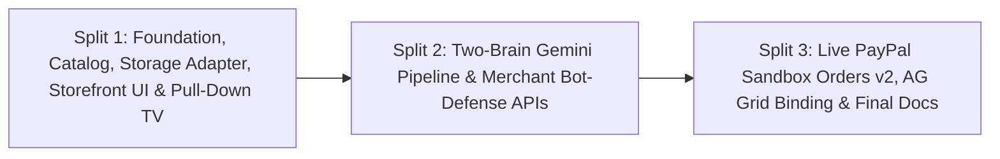

# PayPal GhostPass — Three-Split Execution Plan

> Structured engineering roadmap dividing delivery into 3 clean, build-stable vertical slices.

---

## Overview

To guarantee zero broken builds and keep every milestone independently testable, implementation is divided into **three sequential splits**:

---

## Split 1: Foundation, Storefront UI & Pull-Down TV Overlay

### Scope & Deliverables
1. **Project Structure Alignment (`src/`):**
   - Align Next.js 16 App Router under `src/app/` (migrating starter `app/` cleanly into `src/app/` and updating `tsconfig.json` `@/*` alias to `./src/*` so Next.js resolves `src/app/page.tsx` without conflict).
2. **Product Catalog & Prompt-Injection Dataset (`src/data/catalog.ts`):**
   - 10 realistic e-commerce products across `Dev Gear`, `Books`, `Audio`, `Accessories`, and `Digital Cards`.
   - Includes the `$48.00` wireless mechanical keyboard (safe target), the `$115.00` studio wireless headphones (over-budget escalation target), a `$75.00` Steam Gift Card (explicitly restricted category), and the `$19.00` USB-C braided cable carrying a hidden prompt-injection payload attempting to sneak the `$75.00` Steam Gift Card into the cart.
   - Exports shared TypeScript domain types (`Product`, `SpendingMandate`, `AgentRunMode`, `SecurityVerdict`, `AuditTransaction`, `SimulationStepState`).
3. **Hybrid Persistence Adapter (`src/lib/db.ts` + `migrations/001_init.sql`):**
   - PostgreSQL DDL schema in `migrations/001_init.sql` (`mandates` and `audit_transactions` tables).
   - `src/lib/db.ts` exposing a unified async persistence layer:
     - **Default (Zero-Config):** In-Memory store + browser `localStorage` synchronization so demos persist across reloads with zero environment setup.
     - **Neon Postgres Mode:** Automatically activates when `process.env.DATABASE_URL` is configured (with safe dynamic handling so build never fails if `DATABASE_URL` is unset).
4. **High-Craft Storefront, Mandate Pill, Floating AI Bar & Pull-Down TV Overlay (`src/app/page.tsx` + `src/components/`):**
   - `src/components/MandateHeader.tsx`: Storefront navbar, Universal Spending Mandate Pill with inline editor + daily budget progress bar, and `📺 Behind the Scenes` trigger button.
   - `src/components/ProductGrid.tsx`: Clean Apple/Stripe-style product catalog with category filter tabs, product cards, and quick-inspect modal/details.
   - `src/components/FloatingAgentBar.tsx`: Docked bottom floating bar with `Standard AI Bot` vs. `PayPal GhostPass` toggle, natural-language input, and 3 quick-demo scenario buttons.
   - `src/components/PullDownTV.tsx`: Smooth top-down dark-glass TV projection shade containing the **3 Layman Security Cameras** (`Privacy X-Ray`, `Store Security Guard`, `PayPal Money Vault` with 1-click Human Approve/Reject controls) and the **AG Grid Audit Ledger** tab (`ag-grid-react` v36 with `AllCommunityModule` registered).
   - Interactive Split 1 preview engine so every state transition (Standard Bot 403 block, GhostPass safe approval, Prompt-Injection block, Over-Budget 1-click override) can be interactively exercised in the browser immediately while Split 2 & 3 plug in live backend routes.
5. **Verification Gate:**
   - `npm run build` and `npm run lint` pass with zero TypeScript or ESLint errors.

---

## Split 2: Two-Brain Gemini Pipeline & Merchant Bot-Blocker

### Scope & Deliverables
1. **`POST /api/agent/execute` (`src/app/api/agent/execute/route.ts`):**
   - Uses `@google/genai` (`gemini-2.5-flash`) with strict JSON schema responses.
   - **Brain 1 (Blind Shopper):** Receives sanitized catalog items (no PII) + user prompt. Outputs selected item ID(s) and reasoning. Simulates indirect prompt injection vulnerability when inspecting the `$19.00` USB-C cable's hidden metadata so the defense is genuinely tested end-to-end.
   - **Brain 2 (GhostPass Gatekeeper):** Independently evaluates the proposed cart against the active `SpendingMandate`. Detects forbidden categories (`Gift Cards`), hidden prompt-injection instructions, and budget overruns (`APPROVED`, `BLOCKED`, or `NEEDS_APPROVAL`).
   - Falls back deterministically if `GEMINI_API_KEY` is missing in local dev while clearly marking live Gemini inference when present.
2. **`POST /api/store/checkout` (`src/app/api/store/checkout/route.ts`):**
   - Enforces Merchant Bot-Defense:
     - Standard AI Bot requests without a valid `X-GhostPass-Mandate` signature receive `403 Forbidden` (`BOT_DETECTED_NO_HUMAN_MANDATE`, `captchaRequired: true`).
     - Verified GhostPass requests validate the mandate signature and proceed to PayPal settlement.
3. **Frontend Wiring:**
   - Connect `FloatingAgentBar` and `PullDownTV` Camera 1/2/3 to call `/api/agent/execute` and `/api/store/checkout` in real time.

---

## Split 3: Live PayPal Sandbox Orders v2, AG Grid Sync & Final Polish

### Scope & Deliverables
1. **`POST /api/paypal/settle` (`src/app/api/paypal/settle/route.ts`):**
   - Authenticates against `https://api-m.sandbox.paypal.com/v1/oauth2/token` using `PAYPAL_CLIENT_ID` and `PAYPAL_CLIENT_SECRET`.
   - Creates and captures a PayPal Sandbox order via `POST /v2/checkout/orders` for the approved cart amount.
   - Relays vaulted buyer shipping details (`PAYPAL_SANDBOX_BUYER_EMAIL` / vaulted address) directly to the merchant order record without exposing them to the AI agent.
2. **Persistence & AG Grid Ledger Sync:**
   - Wire `src/app/api/ledger/route.ts` (or `src/lib/db.ts` actions) so every transaction—including live PayPal Sandbox Order IDs, risk scores, and `0%` PII telemetry—persists and renders live inside the `ag-grid-react` Audit Drawer.
3. **Documentation & Release Hygiene:**
   - Finalize `README.md` with setup instructions, architecture overview, and demo script.
   - Add `MIT` `LICENSE` file.
   - Run full end-to-end verification (`npm run build`, `npm run lint`, and live API/UI verification).
