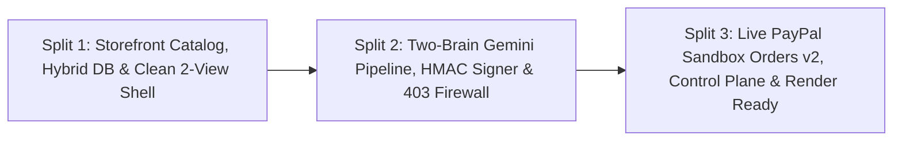

# PayPal GhostPass — Three-Split Execution Plan

> Structured engineering roadmap across all 3 completed vertical slices.

---

## Overview

---

## Split 1: Foundation, Catalog & Storage Adapter (Completed)
- **Catalog (`src/data/catalog.ts`):** 8 flagship NovaTech items with verified Unsplash `4:3` photos + `hiddenHtmlMetadata` prompt-injection trap on the `$19.00` Anker USB-C Cable.
- **Hybrid Persistence (`src/lib/db.ts`, `src/lib/clientStorage.ts`, `src/app/api/state/route.ts`, `migrations/001_init.sql`):** Zero-config Server In-Memory + validated `localStorage` default, seamlessly upgrading to **Neon PostgreSQL** HTTP SQL when `DATABASE_URL` is configured.
- **Pure Retail Storefront (`StoreNavbar.tsx`, `ProductGrid.tsx`, `StoreCheckoutModal.tsx`):** Unobstructed retail storefront + Merchant Order Fulfillment popover.

---

## Split 2: Two-Brain Gemini Pipeline, HMAC Signing & 403 Firewall (Completed)
- **Contracts & Crypto (`src/types/ghostpass.ts`, `src/lib/crypto/mandateSigner.ts`):** `signGhostPassMandate`, `signHumanOverrideToken`, `verifyGhostPassMandate`, and `verifyHumanOverrideToken` using Node `crypto.createHmac("sha256", ...)` + `timingSafeEqual`.
- **Two-Brain Engine (`src/lib/agents/shoppingAgent.ts`, `src/lib/agents/gatekeeperAgent.ts`):** Blind `gemini-2.5-flash` catalog selection (`0% PII`) + deterministic math/regex security guard + `gemini-2.5-flash` semantic audit.
- **APIs (`POST /api/agent/execute`, `POST /api/store/checkout`):** Full `AUTO_APPROVE`, `BLOCK`, `REQUIRE_HUMAN`, and `HTTP 403 BOT_SCRAPER_BLOCKED` enforcement.

---

## Split 3: Live PayPal Sandbox Orders v2, Control Plane Refactor & Render Readiness (Completed)
- **PayPal Sandbox Client & Settlement (`src/lib/paypal/client.ts`, `POST /api/paypal/settle`):**
  - Cached OAuth 2.0 client credentials token exchange (`https://api-m.sandbox.paypal.com/v1/oauth2/token`).
  - Orders v2 (`POST /v2/checkout/orders`, `intent: "CAPTURE"`) with `payee.email_address`, `payment_source.paypal`, automatic capture for `APPROVED` orders, and clean `422` retry resilience.
  - Wired into `POST /api/store/checkout` for both `AUTO_APPROVE` and `HUMAN_OVERRIDE` (`$115` headphones) settlements.
- **2-View Infrastructure UI (`AppShellHeader.tsx`, `ControlPlaneView.tsx`, `AuditLedgerGrid.tsx`):**
  - Removed fake browser chrome and floating bottom-right popups.
  - Built the **GhostPass Control Plane** (Mandate Vault, Sandbox Runner + cURL/MCP snippet, 4-step plain-English pipeline, KPI cards, and filterable AG Grid ledger with PayPal Sandbox links) + **NovaTech Storefront**.
- **Testing, Docs & Render Readiness:**
  - Zero-quota Vitest suites (`mandateSigner`, `gatekeeperAgent`, `checkoutFirewall`, `dbAdapter`, `paypalClient`, `pipeline`).
  - Added `render.yaml`, MIT `LICENSE`, and updated `README.md`, `AGENTS.md`, and `docs/01`–`04`.
